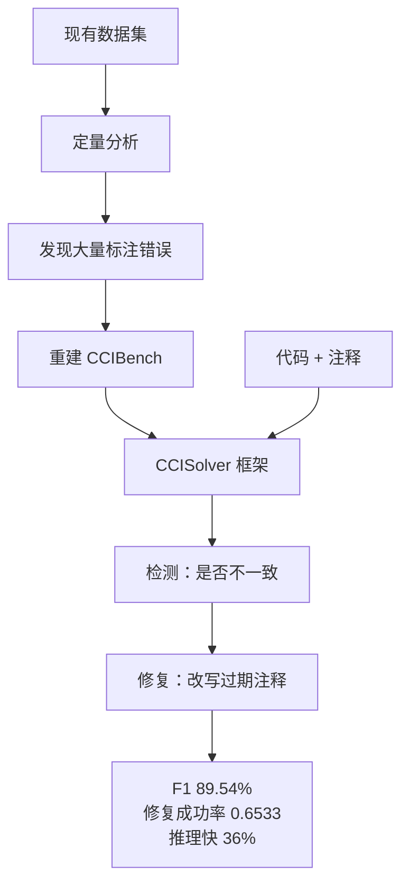

# CCISolver 端到端检测与修复

> 论文：https://arxiv.org/abs/2506.20558
> 名称：CCISolver: End-to-End Detection and Repair of Method-Level Code-Comment Inconsistency

## 基本信息

| 项目 | 内容 |
|------|------|
| **链接** | https://arxiv.org/abs/2506.20558 |
| **发布时间** | 2025-06 |
| **一句话总结** | 先指出现有数据集「相当一部分样本标注错误」，重建 CCIBench 后给出检测与修复一体的框架，检测 F1 达 89.54%，修复成功率 0.6533，推理速度比基线快约 36% |
| **本文对应** | 子问题一（量化）、子问题二（结论靠不靠谱） |

## 置信度评估

| 信号 | 评估 |
|------|------|
| 发表场所 | arXiv 预印本（2025-06） |
| 引用/影响 | 中（较新，但 F1 数字是该任务目前最高） |
| 代码可用 | 论文给出数据集与框架描述，未查到公开实现仓 |
| 实验规模 | 大（发现数据集标注问题后重建了 CCIBench，含人工评测） |
| **综合置信度** | **🟢 高** |
| 需谨慎点 | 单元是「方法与其注释」，粒度比模块级卡片细得多；F1 89.54% 是该任务口径，不能直接搬到文档级 |

## 它解决了什么问题

论文先给了一个定量诊断：**对现有数据集抽样分析后发现相当一部分数据是错标的**。这个发现的份量超过它自己的方法。

错标的后果是连锁的：**用错标数据训练，模型的评估基准就是歪的；用错标数据评测，报出的 F1 不可信**。所以论文先重建数据集 CCIBench，再在此基础上做检测与修复。

作者的判断是，此前的研究「数据集不准、方案不完整」，导致实用性被削弱。检测出不一致之后没有修复，链条是断的。

## 方法核心

框架做两件事：**检测**与**修复**，端到端连起来。

三点：

**一、先修数据再谈方法。** 论文没有直接提方法，而是先把数据集的问题摆出来。这个顺序说明作者认为**在没有可信基准的情况下，方法层面的提升数字没有意义**。

**二、检测与修复放在同一个框架里。** 检测出不一致只是指出了问题，修复才让代码库变好。端到端的设计也意味着检测的判定标准要照顾修复的可行性。

**三、推理速度比基线快约 36%。** 论文把速度作为卖点，说明这个任务被定位成「要能经常跑、跑得起」，与文档生成流水线每天跑一次的场景吻合。

## 关键数据

| 指标 | 数值 |
|---|---|
| 检测 F1 | **89.54%**（论文称达到新最先进水平） |
| 修复的 GLEU 相对提升 | **18.84%**（相对最强基线） |
| 修复成功率（人工评测） | **0.6533** |
| 推理速度 | **比基线快约 36%** |
| 数据集问题 | 抽样分析发现**相当一部分标注错误** |

**三个数字该怎么读**：

- 检测 F1 89.54% 是这个任务上的高位，比 METAMON 的 0.72 precision 好很多。但**两者任务不同**，注释通常紧贴代码、语义关联明确，而独立文档与代码的距离更远
- 修复成功率 0.6533 意味着约三分之一的修复没成功。**作为自动修复偏低，作为「给人工的修改建议」则可用**
- 速度提升 36% 说明这条路线的成本可控，可以经常跑

## 局限

- **单元是方法与其注释**，比模块级知识卡片细。论文的 F1 不能直接当作文档级一致性的预期值
- **未查到公开实现**，CCIBench 的获取方式论文未在摘要层面说明
- **人工评测只覆盖修复任务**（成功率 0.6533），检测任务的准确性评估方式未在摘要中详述
- **论文只针对方法级一致**，涉及跨文件、跨模块的一致性问题不在范围内
- 「相当一部分标注错误」的具体比例论文未在摘要中给出，**需读全文确认**。这个数字对判断现有基准可信度很关键

## 对本项目的启发

### 方案要点

**这篇给的是「先有可信基准，再谈方法提升」这条方法论，以及一个关键的警示：一致性检测的公开数据集本身可能是错的。**

用户第 2 问关心「怎么知道模型说得对」。常规答案是算 precision 与 recall，但前提是**标注是对的**。CCISolver 说明这个前提经常不成立。落到本项目：**如果自建评测集用来算模型的 precision/recall，必须先确认标注质量**，否则得到的数字只是把自己的标注偏差当成模型的准确率。

### 三条可操作的结论

1. **评测集要先做内部一致性检验再用于算指标**。做法是抽一批样本双人独立标注、算标注者一致性（Cohen's kappa 一类），再把分歧条款合成定论。这一步的成本不高，但**能挡住「用错标数据评测模型」这类最隐蔽的错误**。项目此前在别的专题里已确认过这个做法（同类论文的人工标注 kappa 达 0.92），这里可以直接沿用
2. **检测与修复一体的设计值得考虑**。用户方案目前只做检测（四类结论），修复由人工做。CCISolver 说明修复可以由框架给建议，成功率约 65%。**对本项目的含义是：人工评审界面除了展示结论，还可以展示「建议怎么改」，把评审从「判断对不对」变成「判断改得对不对」**。后者通常更快
3. **速度作为设计目标**。每天跑一次的流水线，如果一致性分析成本过高，会减少跑的频率。36% 的速度提升意味着这个环节可以放在每日流程里，而不是攒成周报

### 与既有设计的衔接

项目 `Review` 角色的职责是文档修订，`CheckAgent` 负责判定差异。CCISolver 的「检测加修复」一体，落在项目里是 **Check 与 Review 的接口形状问题**：如果 Check 只能报「不一致」，Review 要自己重新理解上下文；如果 Check 连「建议怎么改」一起产出，Review 的工作量下降，但**Check 的输出会带上未经确认的修改意图**。

`CheckAgent.md` 里有相关约束：「模型输出的自由分析与程序组装的证据应可区分，保留原始回答与最终报告的对应关系」。这意味着**修复建议可以作为「自由分析」的一部分留给 Review 参考，但不能混进证据字段**。这样既享受 CCISolver 的好处，又不破坏既有的证据边界。
