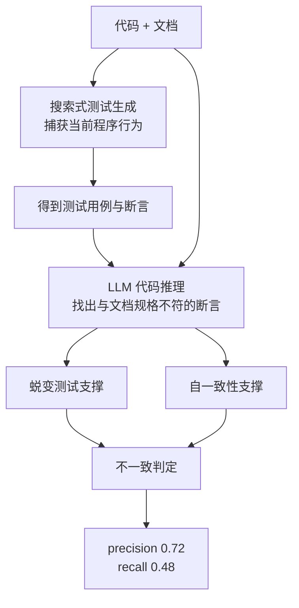

# METAMON 用测试捕获行为再判不一致

> 论文：https://arxiv.org/abs/2502.02794
> 名称：METAMON: Finding Inconsistencies between Program Documentation and Behavior using Metamorphic LLM Queries

## 基本信息

| 项目 | 内容 |
|------|------|
| **链接** | https://arxiv.org/abs/2502.02794 |
| **作者** | Saranya Alagarsamy, Chakkrit Tantithamthavorn, Aldeida Aleti（莫纳什大学） |
| **发布时间** | 2025-02-04 |
| **一句话总结** | 文档不能像代码那样靠执行验证，于是先用搜索式测试生成把程序当前行为固化成测试用例，再让模型找出与文档规格不符的断言，precision 0.72、recall 0.48 |
| **本文对应** | 子问题一（怎么量化）、子问题二（结论靠不靠谱） |

## 置信度评估

| 信号 | 评估 |
|------|------|
| 发表场所 | arXiv 预印本（2025-02） |
| 引用/影响 | 中（较新） |
| 代码可用 | 论文描述完整，未查到公开实现仓 |
| 实验规模 | 大（9,482 对代码与文档，来自 Defects4J v2.0.1 的 5 个开源项目） |
| **综合置信度** | **🟢 高** |
| 需谨慎点 | 单元是方法级的代码片段与文档对照，不是「一次 Git Diff 对应一批卡片」；recall 0.48 意味着漏报超过一半 |

## 它解决了什么问题

论文开头点出的困难很根本：**代码可以被执行验证，文档不能**。一段代码对不对，跑测试就知道；一段文档说得对不对，没有同等强度的自动手段。所以文档与真实行为的不一致会长期潜伏，而要发现它「由于需要人工工程师参与，成本很高」。

这个判断对文档生成流水线有直接意义。流水线每天根据 Git Diff 产出卡片，卡片说的是代码「应当」做什么。**要验证它，需要一个独立于文档的行为基准。**

## 方法核心

三段结构，关键在中间一环。

**第一段：搜索式测试生成捕获行为。** 用已有的基于搜索的测试生成技术，把程序**当前的实际行为**固化成测试用例。这一步不涉及文档，纯粹是「代码实际会做什么」。

**第二段：LLM 代码推理找不符的断言。** 把文档规格与生成的回归测试断言一起交给模型，让它判断哪些断言与文档所述不符。判定的对象从「文档与代码是否一致」变成了「文档与这些断言是否一致」。

**第三段：蜕变测试与自一致性做支撑。** 论文用这两种手段支撑判定，不是单次模型调用的裸结果。

**为什么这个转法有效**：断言是行为的可复现快照，比原始代码更容易与自然语言文档对照，而且它本身是程序生成的、可复现的。这给判定提供了一个稳定基准。

## 关键数据

| 指标 | 数值 |
|---|---|
| 评测规模 | 9,482 对代码与文档 |
| 数据来源 | Defects4J v2.0.1 的 5 个开源项目 |
| **precision** | **0.72** |
| **recall** | **0.48** |

**这两个数字该怎么读**：precision 0.72 意味着报出来的十条里约七条是真问题，作为**人工评审的参考**是可以的。recall 0.48 意味着实际存在的不一致里有超过一半没被发现。**这个漏报率是纯模型路线无法回避的短板，也正是需要确定性层补位的理由。**

## 局限

- **recall 0.48 是本方法自己的数字**，说明它不能作为唯一防线
- **实验单元是方法级的代码与文档片段对照**，不是仓库级的「一次变更对应一批卡片」。迁移到流水线需要自己定义改动单元与卡片的对应关系
- **依赖测试生成的质量**。若某段代码的行为难以生成有效测试（比如涉及并发、时序、外部依赖），这条路线就退化成纯文本比对
- **未查到公开实现**，复现需要自己搭搜索式测试生成这一环
- 论文未报告运行时开销，而搜索式测试生成通常比单次模型调用昂贵得多

## 对本项目的启发

### 方案要点

**这是把一致性分析从「读文本做判断」升级为「对着可执行行为做判断」的最直接方案，也是本项目最应该吸收的一条。**

用户方案是把 Git Diff 文本与卡片正文直接交给模型。METAMON 说明还有一条更硬的路：**先用测试固定住代码的真实行为，再判断文档与该行为的差距**。这样做的好处有三层：

- 判定对象从代码变成断言，**断言是行为的可复现快照**，比代码更容易与自然语言对照
- 即使模型的语义判断有偏差，**错误也会落在具体断言上**，人工复核时能直接看到模型是拿哪条行为做依据的
- 它天然满足了「结论要附可点击证据」的要求：**证据取自真实执行的断言，而不是模型引用的代码片段**

### 三条可操作的结论

1. **覆盖率与过度声称率可以用断言做分母**。用户要的三类量化指标里，最缺的是「分母怎么定」。METAMON 给出了一个具体答案：**以捕获到的行为断言为分母**。改动点覆盖了多少、文档声称了多少条行为、其中多少条断言不支持，都可以落在这个分母上。这比「改动点」更可核对，因为断言是可枚举的
2. **recall 0.48 决定了必须保留第二条发现路径**。如果只做模型判定，一半的不一致会漏掉。**建议确定性层承担「找可疑点」，模型层承担「判可疑点是否真不一致」**，而不是让模型一次做完两件事。这与 `2512.19883` 的结构化改动清单是配套关系
3. **precision 0.72 支持「作为评审参考」这一定位**。用户方案明确说结论不直接决定发布、要人工确认。0.72 这个数字说明这一定位是合理的，但**也要求评审界面必须能展示判定依据**，否则人工无法在 28% 的误报里做甄别

### 与既有设计的衔接

`CheckAgent.md` 写「**不能把简单名称搜索等同于行为一致性判定**」。METAMON 正是这条约束的实现路径：**行为一致性要靠执行捕获的行为去判定，名称搜索只能用于定位候选**。项目里 TestGenAgent 已具备测试生成能力，METAMON 的路线在项目内是可行的，不需要引入新的外部系统。

另外，`Evaluation.md` 的验收条目里已有「14 个公开接口的文档覆盖可逐项核对」，这与「以断言为分母」的思路相容：**先把可比对项枚举出来，再逐项判**。

### 需要注意的边界

METAMON 的单元是「一个方法 + 它的文档」。流水线的单元是「一次 Git Diff + 本次生成的一批卡片」，是**多对多**的关系。要用这个方法，需要先解决「哪段代码改动对应哪张卡片」的对应问题。这一环在用户方案里没有明确，而它决定了分母怎么算。
