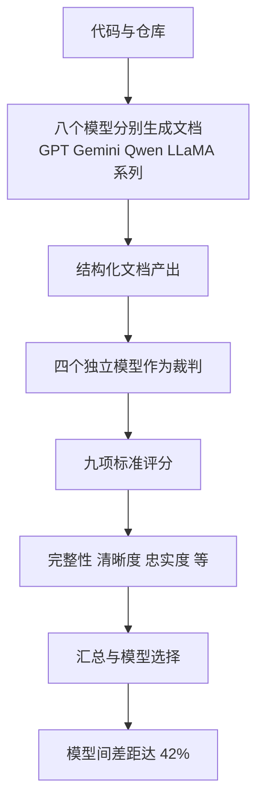

# 多裁判评测文档生成

> 论文：https://arxiv.org/abs/2606.09852
> 名称：LLM-Based Code Documentation Generation and Multi-Judge Evaluation

## 基本信息

| 项目 | 内容 |
|------|------|
| **链接** | https://arxiv.org/abs/2606.09852 |
| **发布时间** | 2026-06 |
| **一句话总结** | 用八个模型生成代码文档，再用四个独立模型按九项标准交叉评分，实测模型间存在 42% 的性能差距 |
| **本文对应** | 子问题二（结论靠不靠谱）、子问题一（量化） |

## 置信度评估

| 信号 | 评估 |
|------|------|
| 发表场所 | arXiv 预印本（2026-06） |
| 引用/影响 | 低（新发布） |
| 代码可用 | 未查到公开实现，使用 PocketFlow 编排框架 |
| 实验设计 | 中（单领域开源库实测，多模型多标准交叉评分） |
| **综合置信度** | **🟡 中** |
| 需谨慎点 | 单领域（医学物理库）；评分者本身是模型，其偏差未单独分析 |

## 它解决了什么问题

高质量文档很重要，但在关键领域常被忽视。论文的场景是医疗这类**可靠性与可维护性要求高**的领域，用八个模型自动从代码与仓库生成文档，并需要一个办法判断哪批产出更好、该选哪个模型。

难点在于**文档质量没有客观的自动指标**。代码对不对可以跑测试，文档好不好只能靠人看，而人工评审成本高、主观性强。

论文的方案是**用裁判团替代单点判断**：让四个独立模型各自给文档打分，再汇总。

## 方法核心

两部分：多模型生成、多裁判评测。

**九项评分标准**包括完整性（Completeness）、清晰度（Clarity）、忠实度（Faithfulness）等。**忠实度这一项直接对应用户关注的「文档是否如实反映代码」**。

论文用 PocketFlow 做编排，采用模块化流水线加提示词工程来产出结构化、有上下文的文档。

## 关键数据

| 指标 | 数值 |
|---|---|
| 参与生成的模型数 | 8 |
| 参与评测的裁判模型数 | 4 |
| 评分标准数 | 9 |
| **模型间性能差距** | **42%** |
| 实验领域 | 开源医学物理库 |

**42% 的性能差距**说明模型选择对这个任务的影响很大，不是「随便哪个都行」。这也是论文把「多裁判评测」作为贡献之一的原因：**要有可信的方法才能选出对的模型**。

## 局限

- **裁判本身是模型，其偏差未单独分析**。四个模型交叉评分比单个裁判稳健，但仍可能有共同偏差（比如都偏好篇幅长的文档）。同专题的 `2608.00884` 说明模型判断可能依赖捷径信号，这个风险对裁判同样存在
- **单领域实验**（医学物理库），结论外推到其他技术栈需验证
- **九项标准的定义与权重未在摘要层面说明**，可复现性受限
- **未把自动评分与人工评分做对照**，因此「裁判团的分」与「人认为的好」相关性有多高，论文没有回答
- 未查到公开实现

## 对本项目的启发

### 方案要点

**这篇给的是「多维度分项评分」这个形态，用在文档质量的量化上。它比单一分数更有诊断价值。**

用户第 1 问想要更细粒度的量化。多裁判九标准这条路提供了一种切分方式：**不追求一个总体的「一致性分数」，而是拆成完整性、清晰度、忠实度等维度分别打分**。对本项目特别有意义的是「忠实度」这一维，它几乎等同于「文档是否如实反映代码」。

### 三条可操作的结论

1. **一致性可以拆成几个可分别评分的维度，而不是一个笼统的结论**。用户方案的四类结论（COVERED / OVERSTATED / UNDERSERVED / DRIFT）是**分类**，不是**分数**。多加一层分项评分的好处是：同一批卡片可以说「覆盖率 70%、忠实度高、完整性中」，这比四类标签更能反映真实状态，也更容易看出该改哪里。**建议把覆盖率（对应 UNDERSERVED 的反面）与忠实度（对应 OVERSTATED 的反面）作为两个独立维度**
2. **多裁判比单裁判稳健，但要防共同偏差**。论文用四个模型交叉评分。**对本项目的含义是：一致性判定也可以用多个判定结果做交叉**。但要注意 `2608.00884` 的警告：如果几个模型都靠同样的捷径信号，交叉也挡不住偏差。**可行做法是让不同判定走不同的依据路径**（一路看断言、一路看结构性改动），而不是让同一个模型换个提示词跑两遍
3. **模型选择的影响有 42%，值得单独测**。项目只能用本地部署的模型，可选范围有限。**建议在正式接入前，用自建评测集把可用的几个模型各跑一遍**，看忠实度这一维的差距有多大。这个测试成本不高，但决定后续所有判定质量的上限

### 与既有设计的衔接

项目 `Evaluation.md` 里已有 `qualityScore`（0 到 100）这类质量信号，但此前调研已确认「质量信号只有单一分数加二元事实」。多裁判分项评分正是补这个缺口的方向：**从单一分数扩展成几个可解释的维度分**。

另外，项目 `KnowledgeHealth.schema.json` 已有 `freshness`、`coverage`、`quality` 三个指标位且各需分子分母。**`quality` 这一维可以按本文的思路进一步拆**，但要注意别拆过头：三个指标位是既有契约，在其内部细化比新增顶层指标更稳妥。
