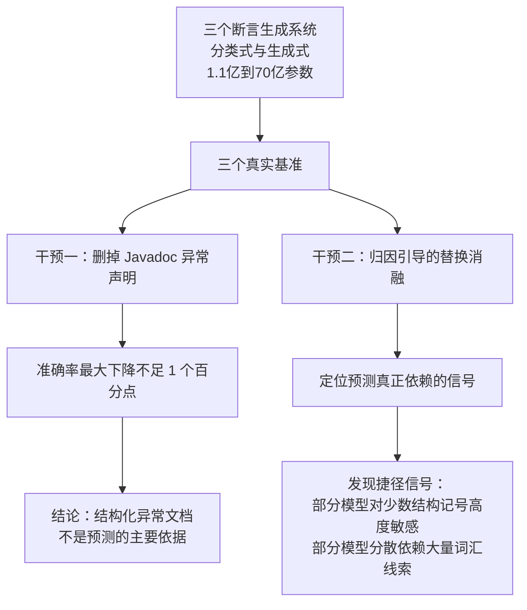

# 捷径信号与依据评测

> 论文：https://arxiv.org/abs/2608.00884
> 名称：Documentation vs. Code Patterns: What Drives LLM-Based Exception Oracle Generation?

## 基本信息

| 项目 | 内容 |
|------|------|
| **链接** | https://arxiv.org/abs/2608.00884 |
| **发布时间** | 2026-08 |
| **一句话总结** | 删掉 Javadoc 里的异常声明后，模型的异常断言预测准确率最大只掉不到一个百分点。判断依赖的是少数结构记号这类捷径信号，文档依据并未真正参与 |
| **本文对应** | 子问题二（怎么评价模型结论本身靠不靠谱） |

## 置信度评估

| 信号 | 评估 |
|------|------|
| 发表场所 | arXiv 预印本（2026-08） |
| 引用/影响 | 低（新发布） |
| 代码可用 | 未查到公开实现 |
| 实验设计 | **好（干预实验加归因引导的替换消融，三个系统、参数量 1.1 亿到 70 亿、三个真实基准）** |
| **综合置信度** | **🟢 高** |
| 需谨慎点 | 任务特定（异常断言生成），结论是「准确率不等于依据可靠」这个一般性提醒在本文任务上的证据 |

## 它解决了什么问题

论文开头问了一个此前没人认真问的问题：**这些模型报告的高准确率，是被什么证据驱动的**？模型究竟是在读 Javadoc 里的异常行为声明，还是靠测试、代码、文档里反复出现的模式在猜？

这个问题对文档生成流水线很关键。如果模型说「这条改动被文档覆盖了」，我们希望它**真的读了文档**，而不是因为「这类改动通常都有文档」而给出这个结论。后者在正常情况下也能得到不低的准确率，**一旦遇到异常情况就会错得莫名其妙**。

## 方法核心

论文用的手段是**干预实验**：把可疑的依据删掉，看准确率变不变。

两个干预：

**干预一：删掉文档依据。** 把 Javadoc 的异常声明从句子里移除，重新评测。**如果模型真的在读文档，准确率应该明显下滑**。

**干预二：归因引导的替换消融。** 系统地替换输入里的成分，看预测依赖哪些信号。这比干预一更细，能定位到「到底靠什么在判断」。

论文评测了三个系统，覆盖**分类式与生成式两种架构**、参数从约 1.1 亿到 70 亿，在**两个生成的测试数据集加一个开发者手写测试的新基准**上做。

## 关键数据

| 干预 | 结果 |
|---|---|
| 删掉 Javadoc 异常声明 | **准确率最大下降不足 1 个百分点** |
| 归因消融 | 部分模型对**少数结构记号高度敏感**；部分模型**分散依赖大量词汇线索** |

**这是本专题里最有警示价值的一组数字。**

删掉文档依据，准确率几乎不变，只能得出一个解释：**模型的预测本来就不怎么依赖那份文档**。它靠的是语料里学到的模式：某些结构记号出现时，通常会有某类异常断言。

论文的结论写得很直接：这些发现「挑战了『异常断言的高准确率反映了对异常语义的稳健使用』这一假设」。它给出的建议是，未来这类系统**不应只按「预测的断言类型对不对」来评价，还要评价「预测是否建立在有意义的触发证据上」**。

## 局限

- **任务是异常断言生成**，不是文档一致性判定。但「准确率高不等于依据可靠」这个提醒是通用的
- **参数量范围是 1.1 亿到 70 亿**，未覆盖更大模型。更大模型是否也依赖捷径信号，论文没有说
- **三个基准里两个是生成测试**，可能自身带有与模型相似的偏差。作者补了一个开发者手写测试的新基准来缓解
- **未给出「如何度量依据可靠性」的具体指标**，只指出了问题与方向
- 未查到公开实现

## 对本项目的启发

### 方案要点

**这篇回答的是用户第 2 问里最难的一层：除了算 precision 和 recall，还要测「模型的判断是不是建立在它声称的依据上」。**

用户方案里模型要指出「哪张卡片」或「哪段代码改动」。这是**声明依据**。`2608.00884` 说明，**声明了依据不等于真的用了依据**。如果一个模型报 OVERSTATED 时总是引用某张卡片，但把那几行卡片内容删掉后它的结论还是不变，那这个结论的可信度是虚的。

**对本项目的具体含义**：一致性分析的评测集除了标注「结论对不对」，还应当支持一次**依据消融实验**：把模型引用的那段材料遮住，看结论是否还成立。这是可以在自建评测集上做的小规模实验，成本不高。

### 三条可操作的结论

1. **评测要加一层「依据敏感性」检验**。做法简单：取一批模型的正确结论，把它声称引用的材料（某张卡片的相关段落、某条改动）替换成无关内容，重跑一次。**如果结论不变，说明这次判断没真的依赖那份材料**。这个检验不需要新标注，只需要改动输入
2. **准确率单独报告会误导**。本项目如果只统计「模型报的不一致里有多少是真的」，就会得到 METAMON 那类 0.72 的数字，看起来可用。但如果这些正确结论里有一部分是碰巧对上的，**换成另一批代码就会失效**。建议在评测报告里同时给出依据敏感性结果
3. **「分散依赖大量词汇线索」这种失败模式与文档生成流水线同源**。文档卡片本身就是词汇密集的文本，模型很容易靠词汇相似度而不是行为一致性下判断。**这正是用户担心的「纯 LLM 对大 diff 可能漏报」的另一面：不是漏报，是错报得很自信**

### 与既有设计的衔接

项目 `CheckAgent.md` 有一条与之呼应的约束：「**不能仅因函数位置、局部变量名称或实现写法不同而宣布行为不一致**」。这条约束防的是「靠表面特征下判断」，`2608.00884` 提供的正是**验证这个约束是否真的生效的手段**：如果模型对表面特征敏感，那么改动这些特征时它的结论就该变。**把「该变的时候有没有变」做成一个可跑的检验，这条约束才从原则变成可验证的约定。**

另外，项目已有「门禁机制：相似度与模型自评分不能覆盖门禁条件」。`2608.00884` 从另一侧支持了这个设计：**既然模型的置信可能建立在捷径上，用它自己的评分去放行就是危险的**。
