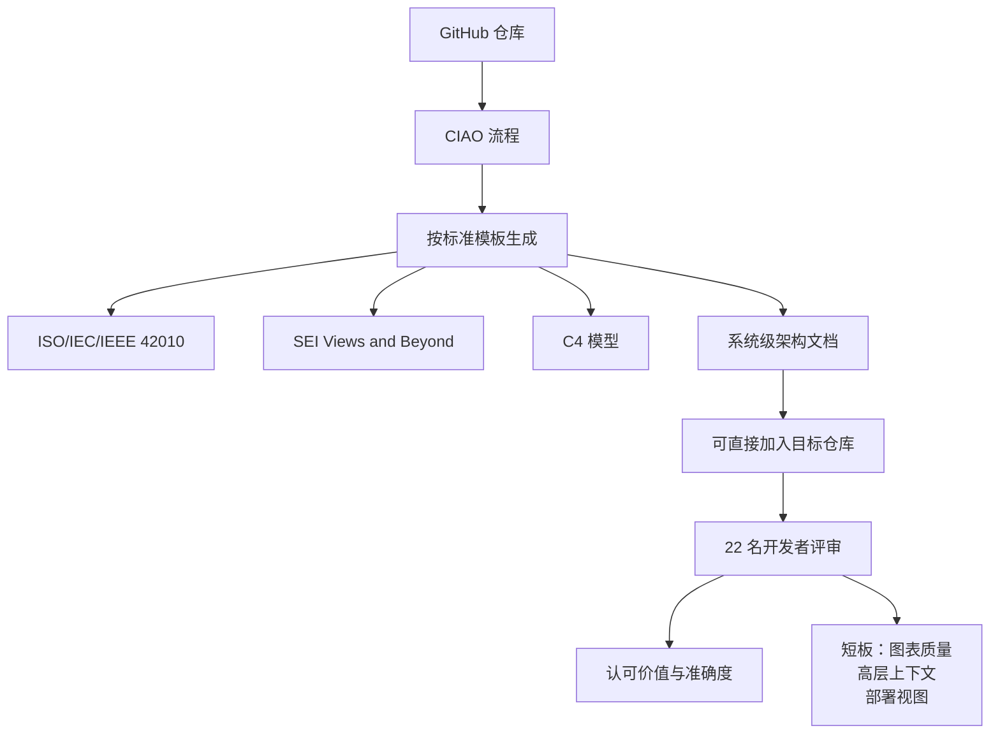

# 架构文档生成的真实评价

> 论文：https://arxiv.org/abs/2604.08293
> 名称：CIAO - Code In Architecture Out - Automated Software Architecture Documentation with Large Language Models

## 基本信息

| 项目 | 内容 |
|------|------|
| **链接** | https://arxiv.org/abs/2604.08293 |
| **发布时间** | 2026-04 |
| **一句话总结** | 从仓库自动生成系统级架构文档，请 22 名开发者评审自己参与过的项目所生成的文档，认可其价值与准确度，但指出图表质量、高层上下文与部署视图是短板 |
| **本文对应** | 子问题一（一致性怎么量化） |

## 置信度评估

| 信号 | 评估 |
|------|------|
| 发表场所 | arXiv 预印本（2026-04） |
| 引用/影响 | 低（新发布） |
| 代码可用 | 未查到公开实现 |
| 实验设计 | **好（22 名开发者评审自己贡献过的仓库所生成的文档，属真实场景评价）** |
| **综合置信度** | **🟢 高** |
| 需谨慎点 | 评价方式是开发者主观感知，不是客观指标；生成的是架构级文档而非模块级卡片 |

## 它解决了什么问题

架构文档对理解系统很关键，但常常缺失或不完整。已有 LLM 技术能从代码生成文档，**但大多处理局部产物，产不出连贯的系统级架构描述**。

论文的切入点是：既然单点生成不够，那就**用一个结构化的流程，按既定标准模板生成系统级文档**。模板来源是三个既有标准：ISO/IEC/IEEE 42010、SEI 的 Views & Beyond、以及 C4 模型。

## 方法核心

流程叫 CIAO（Code In Architecture Out）：输入一个仓库，按标准模板产出系统级架构文档。

**两处设计**：

**一、模板来自成熟标准而非自创。** 文档结构由三个业界标准模板约束，模型只按模板填，不自由发挥。这让"该有哪些内容"变成确定的事，**模型只需负责把内容找出来、写出来**。

**二、评价方式是开发者评审自己熟悉的仓库。** 22 名评审者各自评审**自己贡献过的项目**所生成的文档。这些人对代码库最了解，因此「说得对不对」他们有资格判断。这比找一批不了解项目的人做主观评分可靠得多。

## 关键数据

| 指标 | 结果 |
|---|---|
| 评审人数 | 22 名开发者 |
| 评审对象 | 各自贡献过的仓库所生成的文档 |
| 总体评价 | **有价值、可理解、对源代码而言大体准确** |
| 明确短板 | **图表质量、高层上下文建模、部署视图** |
| 生成成本 | 完整架构文档只需几分钟，成本低 |

**「大体准确」这个评价方式本身值得借鉴**：它没有给出一个百分比数字，而是由熟悉代码的人判断文档是否忠实。这提示一致性评价有一条低成本路径：**找最了解那段代码的人做评审，而不是构造大规模标注**。

## 局限

- **评价是主观感知**，没有客观指标或与其他方法的对照
- **22 名评审者的分歧情况未报告**。这很关键：如果三成人说准、三成人说不准，平均下来「大体准确」就失去意义。**未见一致性统计（kappa 一类）**
- **生成的是架构级文档**（系统级视图），粒度比模块级知识卡片粗。本文的认可不能直接外推到细粒度卡片
- **模板来自通用标准**，对特定技术栈或非传统架构的适配性未讨论
- 未查到公开实现，成本虽低但流程细节不足以复现

## 对本项目的启发

### 方案要点

**这篇给的主要是一种评价方法，不是指标：让熟悉代码库的人评审自己参与过的项目所生成的文档。**

用户第 2 问关心「有没有办法做自动评测，还是只能靠人工标注」。这篇提供了一个介于两者之间的做法：**不做大规模标注，而是小规模、高专业度的定向评审**。22 个人、各自看自己最熟悉的仓库，成本远低于构造标注集，但判断质量不低。

### 三条可操作的结论

1. **小规模定向评审可以作为自动评测的补充与前驱**。在本项目自建评测集的早期，找几位熟悉相关模块的同事做一轮定向评审，**用途是发现「模型错在哪一类上」，不指望它算出指标**。这类定性发现比一个准确率数字更能指导下一步改什么
2. **评审必须报告分歧，不能只报平均印象**。「大体准确」这种表述掩盖了分歧。**建议照同类论文的做法算评审者一致性**（此前专题已确认过 kappa 0.92 的流程可借鉴）。如果分歧大，说明「准确性」这个概念本身在不同人心里定义不同，需要先统一判据
3. **模板驱动的生成能压窄判断范围**。CIAO 用三个标准模板约束该写什么。**对本项目的含义是：卡片类型定义（数据摘要、实体、结构、概念、流程）本身就是一种模板约束**，它让「这张卡片该覆盖什么」变得可核对，从而让覆盖率的分母可算。这条支撑用户第 1 问里覆盖率指标的设计

### 需要注意的边界

本文的短板清单里，「**部署视图与高层上下文建模**」失败得很明确。对本项目的提示是：**不同类型的内容，生成与校验的难度差别很大**。结构、流程这类有明确对应物的内容容易被验证，而「这个模块为什么这样设计」「系统整体的部署形态」这类内容验证起来难得多。**一致性分析的方案应当按内容类型分档，而不是对所有卡片用同一套判定**。这与「知识关联」专题里发现的「只有可测试的行为类陈述适合用执行验证」是同一个结论。

### 与既有设计的衔接

项目 `Review` 角色的存在本身就是「人来看判断对不对」的机制。CIAO 的启示是：**评审者的人选比评审的规模更重要**。项目 `CheckAgent.md` 要求「不能将泛泛的『可能有问题』包装为已确认缺陷」，这与「报告分歧而非平均印象」是同一条纪律的两面：**都要把不确定性显式留下，不要抹平**。
