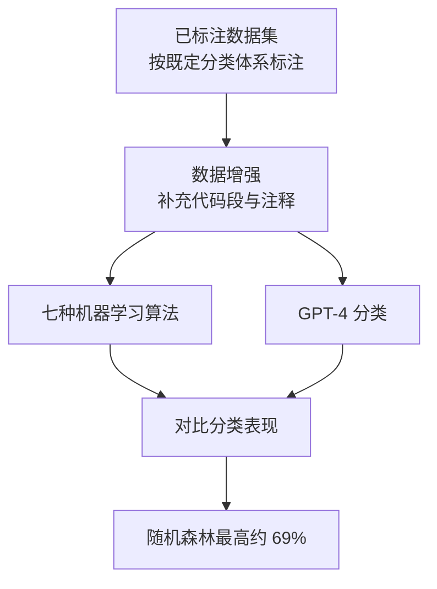

# 注释坏味的检测上限

> 论文：https://arxiv.org/abs/2504.18956
> 名称：Towards Automated Detection of Inline Code Comment Smells

## 基本信息

| 项目 | 内容 |
|------|------|
| **链接** | https://arxiv.org/abs/2504.18956 |
| **发布时间** | 2025-04 |
| **一句话总结** | 用七种机器学习算法与 GPT-4 分类内联注释坏味，实测最高只有约 69% 准确率，说明这类文本层面的质量判定存在明显上限 |
| **本文对应** | 子问题一（量化）、子问题二（结论靠不靠谱） |

## 置信度评估

| 信号 | 评估 |
|------|------|
| 发表场所 | arXiv 预印本（2025-04） |
| 引用/影响 | 低-中 |
| 代码可用 | 未查到公开实现，使用增强后的已标注数据集 |
| 实验设计 | 中（七种机器学习算法与 GPT-4 在同一数据集上对比） |
| **综合置信度** | **🟡 中** |
| 需谨慎点 | 任务是注释坏味的**分类**，不是一致性判定；但结论对「文本层面判定的上限」有参考价值 |

## 它解决了什么问题

代码注释影响可维护性，坏味道的注释会拖累维护。已有研究做过注释坏味的分类体系，但**自动检测仍然困难**。

论文的做法是把这个问题当作分类任务来测：给定一段代码与它的注释，判断属于哪类坏味。然后看机器学习和模型分别能做到什么程度。

## 方法核心

方法本身不复杂，价值在对比设计。

**关键设计**：在不同的方法族上做对比。七种机器学习算法覆盖了典型的统计学习路线，GPT-4 代表模型路线。**同一个数据集、同一个任务、两族方法对比**，这样得出的差距才有意义。

## 关键数据

| 方法 | 表现 |
|---|---|
| 随机森林（七种中最好） | **准确率约 69%** |
| 梯度提升 | 与随机森林接近 |
| GPT-4 | 未优于机器学习方法 |

**69% 这个数字的含义**：这是**文本层面的质量判定**能到达的水平。分类体系的类别数论文未在摘要中说明，因此 69% 相对基线高出多少需要读全文。但可以确认的是，**在这个任务上模型没有明显优势**。

## 局限

- **任务是分类而非一致性判定**，结论不能直接搬到「文档与代码是否一致」
- **类别数与类别平衡情况未在摘要中说明**，影响对 69% 的解读
- **注释坏味与文档一致性是两回事**。坏味指的是注释本身的写作问题（冗余、误导、过时），一致性指的是与代码是否吻合
- **未报告各类别分别的准确率**，因此看不出模型在哪类坏味上失败
- 数据集来自此前工作并做了增强，增强方式对结果的影响未分析

## 对本项目的启发

### 方案要点

**这篇的价值是给了一个参照下限：文本层面的注释质量判定，最好的结果约 69%。**

用户方案的一致性分析要比这个任务难。坏味分类是「给一段注释贴标签」，一致性判定要「把代码改动与文档对应起来再判是否吻合」。**如果前者只有 69%，后者能达到什么水平需要保守预期**。

这个参照对定指标很有用：**如果本项目的自建评测跑出 70% 左右的准确率，不必立刻判定方案失败**，因为同类任务的公开水平就在这个量级。反过来说，**有把握报告 90% 以上的准确率时，应当先怀疑评测集或判定口径有问题**。

### 三条可操作的结论

1. **为本项目的指标定一个合理区间**。参照 METAMON 的 precision 0.72 与本文的 69%，**文档质量类判定的合理预期在 0.7 上下**。把及格线定在 0.9 会导致机制被误判为失败，定在 0.5 又失去了筛选意义。这与「知识关联」专题里「coverage 指标的及格线不能定得太高」是同一个判断
2. **模型在文本质量分类上未必优于传统方法**。这个发现对本项目的模型选型有含义：**在轻量判定环节不必优先上模型**，随机森林这类方法在结构化特征上可能又便宜又准。这条支持用户第 3 问里「先用静态分析提取结构化改动点」的思路：**结构化特征配合简单分类器，是一条被验证过的可行路线**
3. **分类任务要报告分项结果**。论文只报总体准确率，看不出失败集中在哪类。**本项目报告一致性结论时应同时给出四类各自的 precision 与 recall**，否则会掩盖「某一类基本判不准」这种情况

### 与既有设计的衔接

项目既有的质量信号是单一分数（0 到 100）加二元事实。**本文提示这类判定天然有较大偏差，单点分数会掩盖分散度**。与本专题另一篇 `2606.09852` 的结论合起来看：**分项评分比总分更有诊断价值，而对分项也要给区间而非点估计**。
