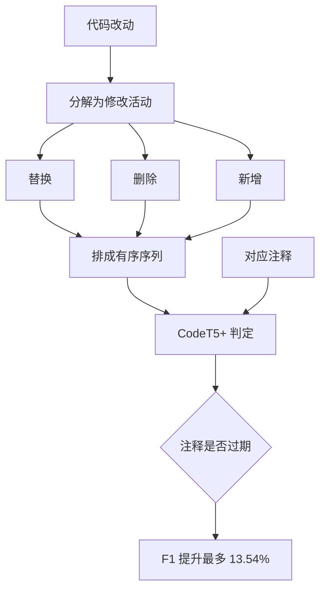

# 结构化改动的注释不一致检测

> 论文：https://arxiv.org/abs/2512.19883
> 名称：Larger Is Not Always Better: Leveraging Structured Code Diffs for Comment Inconsistency Detection

## 基本信息

| 项目 | 内容 |
|------|------|
| **链接** | https://arxiv.org/abs/2512.19883 |
| **发布时间** | 2025-12（预印本） |
| **一句话总结** | 把代码改动分解成「替换、删除、新增」的有序修改活动序列，再判断这批改动是否让注释过期，F1 比最先进方法高最多 13.54% |
| **本文对应** | 子问题三（有没有比纯 LLM 更好的组合方法） |

## 置信度评估

| 信号 | 评估 |
|------|------|
| 发表场所 | arXiv 预印本（2025-12） |
| 引用/影响 | 低（很新） |
| 代码可用 | 未查到公开实现 |
| 实验规模 | 大（两个公开基准 JITDATA 与 CCIBENCH） |
| **综合置信度** | **🟢 高** |
| 需谨慎点 | 评测对象是代码注释而非独立文档；但「改动分解」这一机制与文档生成流水线同构 |

## 它解决了什么问题

论文先描述了一个现象：开发者改了代码却没更新对应注释，注释就变成了误导，后来的人会照着错的做。已有的 LLM 方法想抓「代码改动与过期注释之间的语义关系」，但论文指出它们有共同的缺陷。

**缺陷一：忽略了代码演化的结构复杂度。** 现有方法把改动当成一段文本看，没有区分这次改动到底是替换、删除还是新增，也没有利用改动活动的顺序。可「改了一个返回值」和「删了一个分支」对注释的影响完全不同。

**缺陷二：隐私与资源问题。** 依赖大模型做判定，代码改动要送出去，成本也高。

论文的应对是给自己加了两个约束：**用 CodeT5+ 这种中等规模骨干网络，而不是堆大模型；把改动结构化，让模型少吃数据多拿信息**。这条思路的名字就是「更大不一定更好」。

## 方法核心

核心机制是**把代码改动从「一段 diff 文本」变成「有序的修改活动序列」**。

三个要点：

**一、改动被分解成语义明确的活动类型。** 替换、删除、新增这三类覆盖了最常见的改动形态，每一类对注释的影响方式不同。

**二、活动的顺序被保留。** 同一个函数里先删后加与先加后删，得到的代码可能一样，但对注释的影响路径不同。论文强调有序序列，说明顺序里携带了判断信息。

**三、判定用中等规模模型。** CodeT5+ 参数量远小于通用大模型，论文的定位是「及时检测」，随时跑得起。

## 关键数据

| 指标 | 数值 |
|---|---|
| 相对最先进方法的 F1 提升 | **最高 13.54%** |
| 相对微调后的大模型提升 | **4.18% 到 10.94%** |
| 对比的微调模型 | DeepSeek-Coder、CodeLlama、Qwen2.5-Coder |
| 评测基准 | JITDATA、CCIBENCH |

**要读出的含义**：一个结构化预处理加中等规模模型，**打赢了直接喂大模型的方案**。这说明在「判断一批改动是否让文档过期」这个任务上，**输入的组织形式比模型的规模更重要**。

## 局限

- **评测对象是代码注释，不是独立的知识卡片**。注释通常紧贴代码、粒度更小，而卡片是独立文档、可能覆盖一个模块的多个方面。迁移时粒度要重新定
- **「修改活动」的类型是固定的三类**（替换、删除、新增）。对重命名、移动、签名变更这类改动是否够用，论文没有单独说明
- **未查到公开实现**，三类活动的分解器需要自己实现
- **只做检测不做修复**，判定注释过期之后怎么办不在范围内
- 两个基准都是公开数据集，未见在更复杂仓库上的实测

## 对本项目的启发

### 方案要点

**这是对用户方案第三条（组合方法）最直接的回答：喂给模型的 diff 应当是结构化改动清单，不是原始 diff 文本。**

用户方案目前的做法是把「本次 Git Diff 的文本」直接喂给模型。`2512.19883` 的实测说明这里可以改，而且改动不大：**在送模型之前加一道确定性的改动分解，把 diff 变成带类型的活动序列**。这一道预处理有两个好处，一是提升判断质量，二是**产出可枚举的改动点清单，为覆盖率提供分母**。

### 三条可操作的结论

1. **确定性层的第一步就是把 diff 分解成活动序列**。这一层不需要模型，用语法分析或成熟的 diff 库就能做，改动类型至少区分替换、删除、新增三类。产出的清单有两重身份：既是模型的输入，也是覆盖率的统计底表
2. **这个清单能直接补上 UNDERSERVED 的判定依据**。用户方案里 UNDERSERVED 要指出「哪段代码改动没有对应文档」。现在有了结构化清单，**每一类改动都可以逐条核对是否有卡片提及**，而不是让模型在原始 diff 里自己找。这也回应了 `CheckAgent.md` 的约束「不能仅凭未检索到名称证明实现缺失」：判定依据从「名字搜不到」变成「这条改动活动没有任何卡片对应」
3. **中等规模模型够用这一点对项目有利**。项目用公司本地部署的模型，选型受限。这篇说明**结构化输入能补偿模型规模**，不必在模型档位上纠结。这与项目只能用本地 GLM 5.1 的现实是相容的

### 一个可以借鉴的中间指标

论文没有明说，但从机制可以推出一组**可量化的中间指标**，正好是用户第 3 问想要的东西：

| 中间指标 | 怎么算 | 意义 |
|---|---|---|
| 改动活动总数 | 分解器输出 | 覆盖率的**分母** |
| 被卡片提及的活动数 | 逐条核对 | 覆盖率的**分子** |
| 活动类型分布 | 按替换/删除/新增分类计数 | **删除类改动最易漏覆盖**，因为文档通常只加不减 |
| 未匹配活动的类型 | 未匹配项的分布 | 指出漏覆盖集中在哪类改动上 |

**「删除类改动最易漏覆盖」是一个可以直接验证的假设**，用上面这组指标跑一批真实数据就能验证。这类指标的好处是不依赖模型，可复现，也不会因为模型换了就变。

### 与既有设计的衔接

`CheckAgent.md` 已经写定「**程序可以推导的内容不要求模型重复手填**」。改动活动分解正是典型的「程序可以推导的内容」：diff 摆在那里，分解结果是确定的。把这个活交给程序，模型只判断「这条改动让哪张卡片过期」，职责划分与既有约束一致。

另外，论文用 CodeT5+ 做判定、输入是结构化序列，这个形状与项目「模型输出结构化结论」的要求相容：**输入结构化，输出也结构化**，中间的判定空间被压窄，出错面更小。
