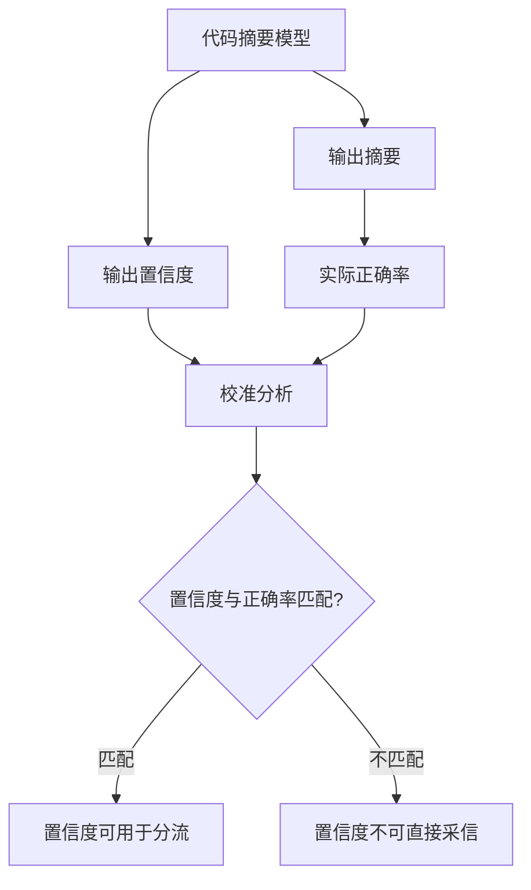

# 代码摘要的忠实度校准

> 论文：https://arxiv.org/abs/2404.19318
> 名称：Calibration of Large Language Models on Code Summarization

## 基本信息

| 项目 | 内容 |
|------|------|
| **链接** | https://arxiv.org/abs/2404.19318 |
| **发布时间** | 2024-04 |
| **一句话总结** | 研究代码摘要模型输出的置信度是否校准，即模型「有多确定」与实际正确率是否匹配 |
| **本文对应** | 子问题三（覆盖率）、子问题二（结论可靠性） |

## 置信度评估

| 信号 | 评估 |
|------|------|
| 发表场所 | arXiv 预印本（2024-04） |
| 引用/影响 | 低-中 |
| 代码可用 | 未查到公开实现 |
| 实验设计 | 中（针对代码摘要任务的校准研究） |
| **综合置信度** | **🟡 中** |
| 需谨慎点 | 未在摘要层面读到具体数值；任务是代码摘要而非覆盖率判定 |

## 它解决了什么问题

模型生成代码摘要时会输出一个结果，但**不会说它有多确定**。如果模型输出置信度，下游就能按置信度分流：高置信的直接用，低置信的送人工。

问题在于：**模型自报的置信度是否可信**？「校准」（calibration）就是研究这件事：**模型说 80% 有把握的时候，实际正确率是不是真的约 80%**。

论文针对代码摘要任务研究这个性质。

## 方法核心

校准分析的判据是：**把输出按置信度分桶，看每桶的实际正确率是否接近桶内平均置信度**。若模型说 90% 的那批实际只有 60% 对，就是过度自信。

## 关键数据

论文摘要层面**未给出具体的校准误差数值**。这一点必须如实说明。

## 局限

- **任务与覆盖率的距离较远**。校准研究的是「模型有多确定」，覆盖率问的是「有没有漏」。两者相关但不同
- **未在摘要层面读到具体数值**
- **未查到公开实现**
- **未涉及「如何利用校准结果做分流」的工程方案**
- 代码摘要是「代码到摘要」方向，本项目要判断的是「摘要（卡片）到代码」方向的一致性，方向相反

## 对本项目的启发

### 方案要点

**这篇的背景价值大于直接价值：它提醒本项目在设计判定机制时，不能假定模型自报的置信度可信。**

### 三条可操作的结论

1. **模型自报置信度必须实测校准后再用**。如果本项目要引入「高置信自动通过、低置信转人工」的分流机制，**前提是先做一次校准测量**：把模型的置信度分桶，看实际正确率。不测就用，分流阈值是拍脑袋的
2. **这与项目既有门禁边界一致**。`Evaluation.md` 明确规定「**相似度、模型自评分和自然语言『通过』不能覆盖这些条件**」。**校准研究为该边界提供了理由**：模型自评分可能系统性偏离实际正确率。项目这条约束是对的，本篇说明它为什么对
3. **分项报告与校准测量可以合并做**。一次评测同时产出两个结果：按类型分项的准确率、按置信度分桶的校准曲线。**后者决定分流阈值怎么定，前者决定哪一类要重点改**

### 一个需要说明的边界

本篇与本目录其他篇的关系：**其他篇回答「怎么判」，本篇回答「判完的产物能不能信」**。它不提供新的判定方法，提供的是**对判定结果的元评估视角**。

这与「文档相似度」专题里 `2608.00884` 的角色类似（那篇也是警示而非方法）。**两篇合起来给出的纪律是：任何模型的输出，在使用前都要有独立于它的检验手段。**

### 与既有设计的衔接

- **`Evaluation.md` 第 32 行的既有边界**：「相似度仅用于归因的既有门禁边界不变」。本组材料（本目录全部 8 篇）都在这个边界内：**产出归因与诊断信号，不作发布依据**
- **`KnowledgeHealth.schema.json`** 已有 `quality` 指标位且需要分子分母。**校准测量产出的正是这一位所需的分母**（分桶后的实际正确率）
