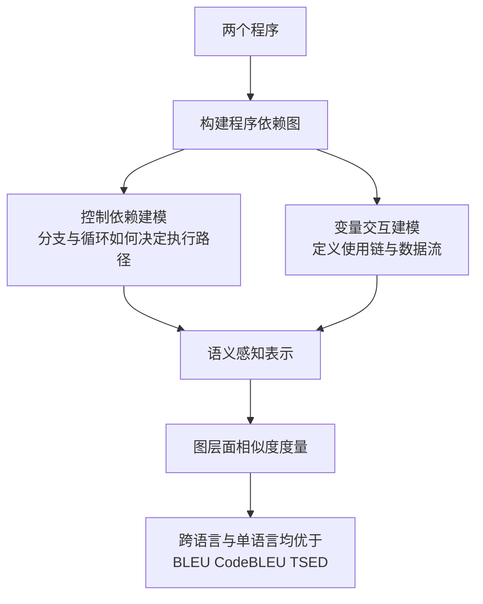

# 依赖图的代码相似度

> 论文：https://arxiv.org/abs/2601.04085
> 名称：CSSG: Measuring Code Similarity with Semantic Graphs

## 基本信息

| 项目 | 内容 |
|------|------|
| **链接** | https://arxiv.org/abs/2601.04085 |
| **发布时间** | 2026-01 |
| **一句话总结** | 用程序依赖图显式建模控制依赖与变量交互，替代 BLEU、CodeBLEU、TSED 这类表面串匹配或语法树指标，在跨语言与单语言设置下均更优 |
| **本文对应** | 子问题一（语义相似度） |

## 置信度评估

| 信号 | 评估 |
|------|------|
| 发表场所 | arXiv 预印本（2026-01） |
| 引用/影响 | 低（新发布） |
| 代码可用 | 未查到公开实现 |
| 实验设计 | 中（单一数据集 CodeContests+，但含单语言与跨语言两种设置） |
| **综合置信度** | **🟡 中-高** |
| 需谨慎点 | 单一数据集验证；度量对象是代码而非文本文档 |

## 它解决了什么问题

论文指出现有代码相似度指标的根本缺陷：**BLEU、CodeBLEU、TSED 主要依赖表面字符串重合或抽象语法树结构，抓不到程序之间更深层的语义关系**。

这三类指标的失效方式各有不同：

- **BLEU**：纯 n-gram 文本重合，改名就掉分
- **CodeBLEU**：加入语法树与数据流，但仍是「长得像不像」
- **TSED**：树编辑距离，结构不同就判为不相似

**共性是都没有显式建模「数据怎么流动、控制怎么走」。**

## 方法核心

CSSG 用**程序依赖图（PDG）**做相似度度量。



**程序依赖图显式建模什么**：

- **控制依赖**：一段代码的执行是否取决于某个条件
- **变量交互**：一个变量在哪里被定义、在哪里被使用

**为什么这比语法树强**：两个程序可以有完全不同的语法树，但**数据流与控制流同构**。程序依赖图抓的是后者，因此能识别「换了写法但做同一件事」。

论文强调这提供了一种**语义感知的表示**（semantics-aware representation）。

## 关键数据

论文的实验结论分两个设置：

| 设置 | 结果 |
|---|---|
| 单语言 | CSSG 一致优于既有指标 |
| 跨语言 | CSSG 一致优于既有指标 |

判据是「**区分更相似的代码与不太相似的代码**」的能力。数据集是 **CodeContests+**。

**摘要层面未给出具体数值**，需要如实说明。

## 局限

- **单一数据集验证**（CodeContests+）。竞赛代码的结构特征与工程代码差别较大，未在真实仓库上验证
- **度量对象是代码，不是文本文档**。CSSG 不能直接用来判断两张 Markdown 卡片是否重复
- **未查到公开实现**
- **未报告计算开销**。构建程序依赖图本身有成本，论文未与轻量指标做开销对比
- **未说明对语言的支持范围**。程序依赖图的构建依赖语言的解析能力，跨语言设置如何实现摘要未详述
- **度量的是相似度而非等价性**。给出的是一个连续分数，不是「是/否同一件事」的判定

## 对本项目的启发

### 方案要点

**CSSG 在本项目的定位落在判断「两次代码改动是不是在改同一个行为」，而非判断卡片是否重复，这是覆盖率判定需要的一个关键中间信号。**

原因：本项目 Q1 问的是卡片层面，但覆盖率（Q3）判定需要知道**改动与改动之间的关系**。比如两条改动在同一个控制流分支上，可能只需一张卡片覆盖；两条改动分别在不同分支，可能需要两张。**这类判断要看数据流与控制流，而不是看改动文本像不像。**

### 三条可操作的结论

1. **覆盖率的分母可以按依赖关系聚合，而不是按文件或行数**。这是本篇给 Q3 的具体贡献：**用程序依赖图把结构化改动清单聚合成「行为级改动单元」**，再判断每个单元是否被卡片覆盖。这比按文件粒度统计更符合「卡片描述一个模块或接口的职责」这个实际形状
2. **代码侧的相似度判定不应使用文本指标**。项目 `Evaluation.md` 已有「相似度仅用于归因」的边界。**本篇为该边界补了一个技术理由**：文本指标测的是表面重合，测不出行为等价。**如果项目要引入代码侧相似度，应当明确选型是依赖图类而非串匹配类**
3. **跨语言能力对本项目是加分项但不是必需**。本项目主要处理单一代码库，跨语言设置的价值有限。**可以优先考虑单语言下的实现简洁性**

### 与「结构化改动清单」的关系

本目录 README 第三部分建议了覆盖率的三层做法，CSSG 补的是**第一层与第二层之间的一环**：

```
diff → 结构化改动清单（第一层，无模型）
     → 【按依赖关系聚合成行为级改动单元】← CSSG 在这里
     → AST 加依赖感知上下文（第二层）
     → 覆盖率核对
```

**这一环的作用是让分母有意义**：如果分母是 47 条改动活动，覆盖率 70% 这个数字很难解读；如果分母是 6 个行为级改动单元，覆盖率 5/6 就清楚得多。

### 与既有设计的衔接

- **`CheckAgent.md` 第 64 行**「不把编号索引、相似度算法或新的代码检测系统作为实现前提」。**程序依赖图属于「程序提取」的必要副产品**（要知道某条改动影响什么，本就需要调用关系），实现上可复用项目已有的词法提取能力，边界上说得通
- **`CheckAgent.md` 第 133 行**「相似度算法、评分、权重和阈值留待研究」。本篇是该研究的**输入之一**：它说明如果要做代码侧相似度，应当选依赖图路线而非文本路线
