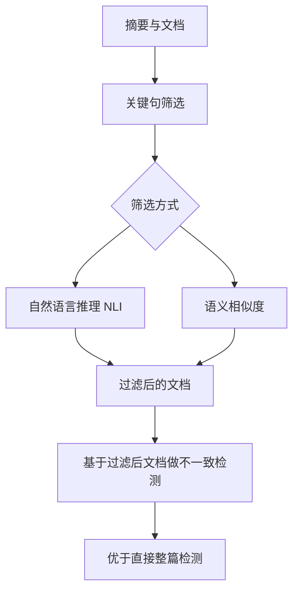

# 关键句过滤提升不一致检测

> 论文：https://arxiv.org/abs/2403.07557
> 名称：SIFiD: Reassess Summary Factual Inconsistency Detection with LLM

## 基本信息

| 项目 | 内容 |
|------|------|
| **链接** | https://arxiv.org/abs/2403.07557 |
| **发布时间** | 2024-03 |
| **一句话总结** | 重新评估 LLM 做不一致检测的表现，发现早期尝试中 LLM 不如传统模型，原因是指令遵循能力与检测方法不足；改用先筛关键句再检测的路子 |
| **本文对应** | 子问题二（事实一致性） |

## 置信度评估

| 信号 | 评估 |
|------|------|
| 发表场所 | arXiv 预印本（2024-03） |
| 引用/影响 | 中（该方向的对比性评估工作） |
| 代码可用 | 未查到公开实现 |
| 实验设计 | 中（对比 GPT-3.5 与 GPT-4，提出并验证 SIFiD） |
| **综合置信度** | **🟡 中-高** |
| 需谨慎点 | 场景是摘要与文档，两侧都是自然语言；未给出具体数值 |

## 它解决了什么问题

论文做了一件「重新评估」的工作。LLM 出现后有不少研究尝试用它们做不一致检测，但论文指出：**早期尝试显示 LLM 表现不如传统模型**。

这个结论有点反直觉，因为 LLM 的语言理解能力明显强于传统方法。论文给出的两个原因是：

1. **指令遵循能力有限**。让模型「找出摘要与文档不一致的地方」这个指令听起来简单，但模型实际执行时会跑偏
2. **缺乏有效的检测方法**。仅靠一个好模型不等于有好方法

**作者的态度是重新评估 LLM 路线，并在方法层面改进。**

## 方法核心

SIFiD 的核心是**先过滤再检测**。

**做法**：用**自然语言推理**或**语义相似度**两种方式之一，识别文档中的**关键句**，然后基于过滤后的文档做检测。

**为什么有效**：文档通常很长，而摘要只覆盖其中一部分。**把整篇文档交给模型做不一致检测，模型要同时完成「找相关内容」与「判是否一致」两件事**。先过滤则把这两件事拆开：过滤阶段负责找，检测阶段只管判。

这与本项目「不要整张卡片丢给模型」的直觉一致。

## 关键数据

论文的结论是 SIFiD 提升了一致性检测表现，但摘要层面**未给出具体数值**。需要如实说明：**方法方向明确，效果数字需读全文确认**。

## 局限

- **场景是摘要与文档**，两者都是自然语言。卡片与代码的跨模态场景更难
- **未给出具体数值**
- **未查到公开实现**
- **关键句筛选本身可能漏掉关键内容**。如果筛选阶段漏了某句，检测阶段就无从发现不一致。这是两级流程的固有风险
- **两种筛选方式（NLI 与语义相似度）的效果差异未在摘要中对比**
- **未报告成本**。SIFiD 增加了一道筛选，但减少了检测阶段的输入长度，净成本变化未知

## 对本项目的启发

### 方案要点

**这篇给的是一条低成本的工程改进：不要让模型直接处理整张卡片，先筛出关键句。**

### 三条可操作的结论

1. **一致性判定的输入需要预处理，不是整篇直送**。知识卡片通常包含多个方面的内容（职责、参数、示例、注意事项），而**一次代码改动可能只涉及其中一两句**。把整张卡片交给模型，它会花注意力在不相关的部分上。**建议先按改动涉及的内容筛出卡片里的相关句，再做判定**
2. **筛选与判定要分开评测**。两级流程的风险是「筛选漏了」和「判定判错」表现相同（都是漏报），但原因不同。**分开评测才能知道该修哪一级**。这与本目录 HyClone 的两阶段设计面临同样的问题
3. **NLI 与语义相似度是两条可选的筛选路线**。论文给了两个选项。**对本项目的建议**：语义相似度实现简单、开销低，适合做第一道；NLI 更准但需要模型。可以先上相似度筛选，效果不足再加 NLI

### 与本目录其他方法的分工

本目录里「先筛后判」这个模式出现了三次，值得指出它们是**同一模式在不同环节的实例**：

| 论文 | 筛选什么 | 判定什么 |
|---|---|---|
| SIFiD `2403.07557` | 文档里的关键句 | 摘要与关键句是否一致 |
| HyClone `2508.01357` | 明显的非克隆对子 | 剩余对子是否功能等价 |
| SemHash-LLM `2607.01601` | 候选重复文档 | 少量候选是否真重复 |

**这个模式在本项目应该成为默认设计**：任何昂贵的判定前面都要有一道便宜的筛选。reason 很直接：模型调用的成本随输入线性上升，而筛选可以把输入规模降一两个数量级。

### 与既有设计的衔接

- **`CheckAgent.md`** 的分析流程已经有类似结构的影子：模型负责指出所依据的规则与位置，**程序从冻结源码中提取、绑定原文**。**这本身就是一种「先定位再判定」的分工**。SIFiD 的启示是可以把这个模式用到卡片侧：先定位卡片里的相关句，再判定
- **`DocGenAgent.md` 第 83 行**提到「上下文预算」问题。**关键句过滤是控制上下文预算的一种手段**，与「读取源码」专题里的过滤思路同源
