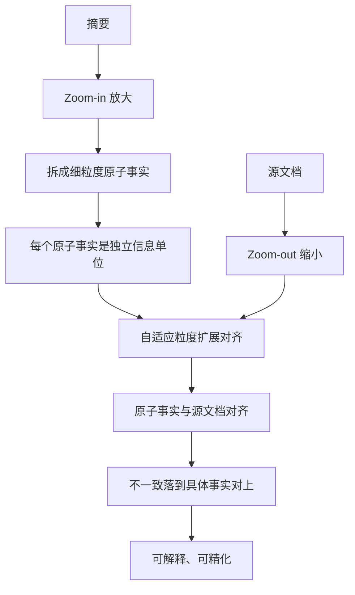

# 原子事实分解与对齐

> 论文：https://arxiv.org/abs/2404.11184
> 名称：FIZZ: Factual Inconsistency Detection by Zoom-in Summary and Zoom-out Document

## 基本信息

| 项目 | 内容 |
|------|------|
| **链接** | https://arxiv.org/abs/2404.11184 |
| **发布时间** | 2024-04 |
| **一句话总结** | 把摘要拆成细粒度原子事实，再用自适应粒度扩展与源文档对齐，让不一致落到具体事实对上，可解释性显著优于整体打分 |
| **本文对应** | 子问题一（语义相似度）、子问题二（事实一致性） |

## 置信度评估

| 信号 | 评估 |
|------|------|
| 发表场所 | arXiv 预印本（2024-04） |
| 引用/影响 | 中（事实一致性检测方向的代表性工作） |
| 代码可用 | 未查到公开实现 |
| 实验设计 | 好（与既有事实一致性检查系统对比，论文称显著优于） |
| **综合置信度** | **🟢 高** |
| 需谨慎点 | 场景是摘要与源文档，不是卡片与代码；原子事实的拆分粒度依赖模型 |

## 它解决了什么问题

摘要系统的事实一致性评估已有大量方法，但论文指出它们有**明显局限，特别是在精化（refinement）与可解释性两方面**。

这个批评很具体：多数方法给出的是一个**整体分数**——「这段摘要有 0.8 的事实一致性」。可这个数字有两个问题：

- **无法精化**：知道分数低，但不知道该改哪句
- **不可解释**：说不清是哪个陈述与哪段原文冲突

论文要解决的是这两点：让不一致判定**落到具体的细粒度单位上**。

## 方法核心

核心是**双向缩放**：把摘要「放大」到原子事实级，把文档「缩小」到可对齐的粒度，然后在两者之间做对齐。

三个关键设计：

**一、原子事实是正确的比较单位。** 论文强调原子事实代表**更细粒度的信息单位**，便于对摘要的事实不一致做细致理解与解释。相比整段比对，原子事实级的判定带来两个好处：**可解释性**（能指出具体哪条事实不一致）与**可精化**（知道要改哪一条）。

**二、双向缩放而非单向。** 摘要侧放大（拆细），文档侧缩小（聚焦相关部分）。两侧粒度在中间相遇，才能对齐。

**三、自适应粒度扩展（adaptive granularity expansion）。** 对齐时粒度是自适应的，不是固定的。这一点很重要：**同一段源文档对不同原子事实的相关粒度可能不同**，固定窗口会切掉关键上下文或引入噪声。

## 关键数据

论文的结论表述是「**显著优于既有事实一致性检查系统**」，但摘要层面**未给出具体数值**。这一点必须如实说明：**方向与机制明确，效果数字需要读全文确认**。

## 局限

- **场景是摘要与源文档**，两侧都是自然语言。本项目要处理的是卡片（自然语言）与代码（形式语言），跨模态对齐难度更高
- **原子事实的拆分质量依赖模型**。拆得太细会产生大量琐碎事实，拆得太粗又失去可解释性。论文的拆分粒度由模型决定，未给出确定性规则
- **未查到公开实现**
- **未报告运行开销**。原子事实分解意味着对同一内容要多次模型调用，成本高于整体打分
- **侧重检测而非修复**。论文提到可精化，但修复环节不在范围内

## 对本项目的启发

### 方案要点

**这是回答「除了 Embedding 还有哪些更可靠方法」最直接的一篇：把文本拆成原子事实再对齐，替代整体向量相似度。**

对本项目有三个具体用处：

**用处一：判两张卡片是否描述同一件事。** 两张卡片各拆成原子事实集合，再做对齐。**重复**表现为事实集高度重叠，**矛盾**表现为同主题事实冲突。这比向量余弦相似度可靠，因为判定落在可比对的单位上。

**用处二：判卡片与代码是否一致。** 卡片的原子事实与代码行为对齐。但要注意跨模态难点：代码这边没有等价的「原子事实」，需要先用静态分析提取结构化行为（对应本目录第三部分）。

**用处三：为矛盾识别提供分类依据。** 与本目录另一篇 CLASH 的对象级/属性级矛盾分类法结合，可以设计出「事实缺失、事实冲突、事实多余」三类的判据。

### 三条可操作的结论

1. **把卡片拆成原子事实，是让判定可解释的前置步骤**。整体分数无法指导修订，项目 `Review` 角色需要的是「哪一句错了」。**建议卡片生成时就产出原子事实列表**，作为卡片的附带结构，而不是判定时临时拆
2. **自适应粒度这个设计要保留**。固定窗口对齐会丢上下文。落到卡片与代码的比对：**同一条事实可能对应一行代码，也可能对应一个函数**，粒度应当自适应
3. **注意拆分成本**。原子事实分解需要模型调用，且粒度越细调用越多。**建议只对候选集做分解**（先用便宜的哈希或相似度粗筛），而不是全量分解

### 与其他方法的配合

本目录里四条 Q1 路线各有分工，**FIZZ 的定位是「精判与定位」**：

| 阶段 | 方法 | 成本 |
|---|---|---|
| 粗筛 | 语义哈希（SemHash-LLM） | 极低 |
| 精判与定位 | **原子事实对齐（本篇）** | 中 |
| 功能等价确认 | 执行验证（HyClone、文档测试） | 高 |

**这构成一条完整的成本阶梯**：便宜的做全量，贵的只处理候选集。这与本目录「执行验证的语义克隆检测」篇的两阶段设计是同一个思路。

### 与既有设计的衔接

- **`DocGenAgent.md` 第 67 行**要求卡片「正文至少 200 字符；标题和摘要不能纯空白；关键词非空、不重复」。**关键词不重复这条已经是一个弱的去重约束**，原子事实集合可以把它升级为结构性约束
- **`DocGenAgent.md` 第 10 行**写 DocGen「负责组织内部 DocWorker、汇总片段、**处理重复与矛盾**」。本篇正是这条职责的具体方法
