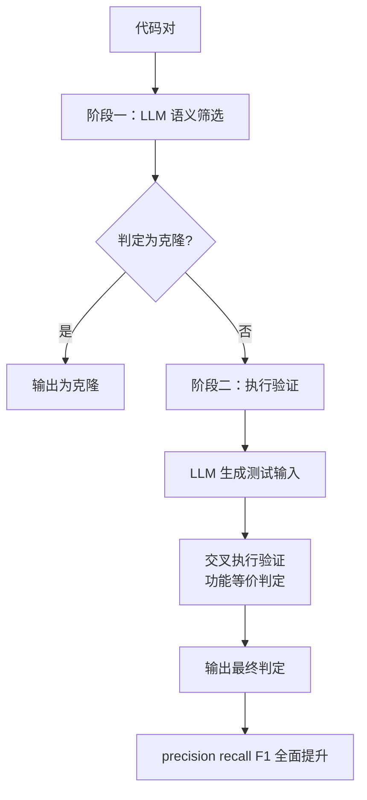

# 执行验证的语义克隆检测

> 论文：https://arxiv.org/abs/2508.01357
> 名称：HyClone: Bridging LLM Understanding and Dynamic Execution for Semantic Code Clone Detection

## 基本信息

| 项目 | 内容 |
|------|------|
| **链接** | https://arxiv.org/abs/2508.01357 |
| **发布时间** | 2025-08 |
| **一句话总结** | 两阶段：模型先做语义筛选剔除明显非克隆的对子，剩下的用模型生成测试输入做交叉执行验证功能等价，precision、recall、F1 全面提升 |
| **本文对应** | 子问题一（语义相似度） |

## 置信度评估

| 信号 | 评估 |
|------|------|
| 发表场所 | arXiv 预印本（2025-08） |
| 引用/影响 | 低（较新） |
| 代码可用 | 未查到公开实现 |
| 实验设计 | 好（与纯 LLM 直接检测对比，三个指标全面提升） |
| **综合置信度** | **🟢 高** |
| 需谨慎点 | 面向 Python 代码克隆，不是文本卡片；执行验证要求代码可运行 |

## 它解决了什么问题

代码克隆检测要找出功能相同但可能语法不同的代码片段。最难的一类是 **Type 4 语义克隆**：**语法结构完全不同，但实现的功能一样**。

论文指出两个现状问题：

- **传统方法抓不到功能等价**。它们依赖语法或结构相似，Type 4 克隆在结构上不相似，因此被漏掉
- **直接上模型效果不佳**。论文的原话是模型「对语法差异敏感」（sensitivity to syntactic differences），因此直接判断会有偏差

**这两条合起来说明：单靠语法结构不行，单靠模型也不行。**

## 方法核心

两阶段分工，第一阶段便宜、第二阶段可靠。

**阶段一：模型语义筛选。** 模型评估代码对，**过滤掉明显不是克隆的**。这一步的作用是把不可能的对子快速剔除，避免昂贵的执行验证对所有对子跑一遍。

**阶段二：执行验证。** 对第一阶段**未被判定为克隆**的对子，用**模型生成测试输入**，通过**交叉执行**评估功能等价。

关键在交叉执行这个设计：**除了分别跑两个实现，还让一个实现的输出作为另一个的输入或与之比对**。这样能抓住「功能等价」而不只是「单次输出相同」。

## 关键数据

论文报告的结论是：相比**直接使用模型的检测**，本框架在 **precision、recall、F1 三项上均有显著提升**（significant improvements）。

**摘要层面未给出具体数值**，这一点需要如实说明。论文的对照对象是「direct LLM-based detection」，因此**提升是相对纯模型路线而言的**。

## 局限

- **面向 Python 代码克隆**，未验证其他语言
- **执行验证要求代码可运行**。无法执行的代码片段（缺依赖、需特定环境、有副作用）会让第二阶段退化
- **测试输入由模型生成，其质量决定判定上限**。若生成的输入覆盖不到关键路径，功能等价的代码可能被误判为不等价
- **未给出具体数值**，无法直接与 METAMON 的 0.72/0.48 或 CCISolver 的 89.54% 对比
- **未查到公开实现**
- **论文自述未来工作**包括跨语言克隆检测与大规模优化，说明当前实现的规模能力有限
- **第二阶段成本高**（生成测试加执行），论文未报告开销

## 对本项目的启发

### 方案要点

**这是「用执行验证判定是否同一件事」最清晰的架构，而它的两阶段分工可以直接搬到卡片去重上。**

用户问「如何判断两张卡片是否描述同一件事」。HyClone 给的答案分两层：

- **便宜的语义筛选**先剔掉明显不是同一件事的（对应 SemHash-LLM 或原子事实粗筛）
- **剩下的用执行验证**确认是否真的功能等价

**关键洞察是第二阶段的必要性**：两张卡片可能用完全不同的措辞描述同一个行为，表面语义相似度不高，但功能上是一回事。**这种情况只有执行才能确认。**

### 三条可操作的结论

1. **「是否同一件事」的最终判定要落在执行上**。落到本项目：如果两张卡片被怀疑描述同一功能，**可以让两张卡片各自生成测试，交叉执行看是否通过同样的断言**。这与本目录「文档测试验证注释准确性」是同一个机制的两种用法：文档测试判「卡片与代码是否一致」，交叉执行判「两张卡片是否同一件事」
2. **两阶段顺序不能颠倒**。先执行验证再语义筛选是错的，因为执行成本高。**必须先便宜地缩小候选集**。这对本项目的直接含义是：去重流程要有明确的候选生成阶段，不能对所有卡片对做重判定
3. **「模型对语法差异敏感」这个失败模式在本项目同样存在**。卡片里同一个业务行为可能有不同的表述结构（一段话描述 vs 分点列出）。**纯语义判定会因表述结构差异而误判**，这支持引入结构不敏感的信号（原子事实集合、执行结果）

### 「执行验证」在本项目的可行范围

需要明确一条边界：**不是所有卡片内容都能用执行验证**。

- **可以用**：描述接口行为、参数含义、返回值、副作用的卡片。这些可以生成测试
- **不能用**：描述设计意图、架构决策、历史原因的卡片。这类内容无法用测试表达

这与本目录 DocSync 论文的判断一致（静态分析管有没有、模型管对不对、执行验证管是不是真的），也回应了「知识关联」专题里的发现：只有可测试的行为类陈述适合执行验证。**建议按卡片类型分档，给不同档位配不同判定路线。**

### 与既有设计的衔接

项目 **TestGenAgent 已具备测试生成与执行能力**，且约束是「只读原始源码与公开接口」。**交叉执行需要的是生成测试输入的能力**，与 TestGenAgent 的能力栈重合。这意味这条路线在本项目内**是能力复用而非新建系统**，符合 `CheckAgent.md` 「不把新的代码检测系统作为实现前提」的约束。
