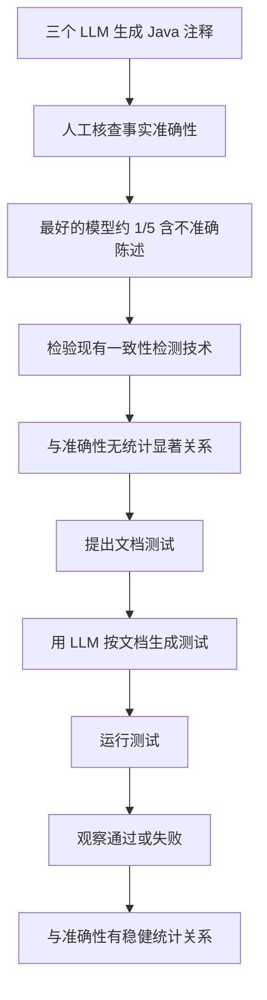

# 文档测试验证注释准确性

> 论文：https://arxiv.org/abs/2406.14836
> 名称：Identifying Inaccurate Descriptions in LLM-generated Code Comments via Test Execution
> 代码：论文未查到公开仓

## 基本信息

| 项目 | 内容 |
|------|------|
| **链接** | https://arxiv.org/abs/2406.14836 |
| **发布时间** | 2024-06 |
| **一句话总结** | 三个模型生成的 Java 注释里最好的也有约五分之一含可证明不准确陈述，而现有代码-注释一致性检测技术与准确性无统计关系；改用「按文档生成测试再执行」后有稳健统计关系 |
| **本文对应** | 子问题二（事实一致性） |

## 置信度评估

| 信号 | 评估 |
|------|------|
| 发表场所 | arXiv 预印本（2024-06） |
| 引用/影响 | 中（该问题的开创性测量工作） |
| 代码可用 | 未查到公开实现 |
| 实验设计 | 好（三个模型对比、对现有一致性检测技术做统计关系检验、定性评估佐证） |
| **综合置信度** | **🟢 高** |
| 需谨慎点 | 实现只覆盖 Java 注释；论文自述当前实现有局限；未给出 precision/recall 具体数值 |

## 它解决了什么问题

论文指出一件此前没被认真测过的事：**生成的注释到底有多准，缺少系统性评估，此前只有主观的准确性标签**。

作者先做了这个测量。让三个模型生成代码注释，然后逐条检查注释里的陈述是否能被代码证明为假。**即使表现最好的模型，约五分之一注释含可证明不准确的陈述**。

有了这个数字，下一个问题很自然：既然注释会错，那**已有的代码-注释一致性检测技术应该能抓出来**。作者去测了，结果推翻了这个预期。

## 方法核心

论文的贡献分两半：一半是**证伪**，一半是**提出替代方案**。

### 证伪部分：一致性检测技术为什么抓不到

论文的实验结论写得很直接：现有的代码-注释一致性检测技术**与注释准确性之间没有统计显著关系**。作者用「underscoring the substantial difficulty of this problem」来描述这个结果。

值得注意这里的逻辑：**不是说这些技术完全无效，而是说它们测的东西与实际准确性是两件不同的事**。它们可能测的是「注释与代码有没有词汇重合」，而注释的错误在于**声称了代码没做的行为**，这两者的度量对象并不相同。

### 替代方案：文档测试

作者把新概念叫 **document testing（文档测试）**，机制是三步：

1. **用 LLM 根据文档生成测试**。文档说这段代码做什么，就按这个说法写测试
2. **运行这些测试**
3. **观察通过或失败**。通过说明代码行为与文档所述一致；失败说明存在不一致

**为什么这个转法有效**：它把「文档对不对」这个**无法直接验证的语义问题**，换成了「按文档写的测试能不能过」这个**可执行的判定**。文档若如实描述了行为，测试就该通过；若声称了代码没做的行为，测试就会失败。

论文实测这条路**与注释准确性有稳健的统计关系**，而此前技术做不到。

## 关键数据

| 指标 | 数值 |
|---|---|
| 检查的模型数 | 3 |
| 最好模型的注释中含可证明不准确陈述的比例 | **约五分之一** |
| 现有一致性检测技术与准确性的关系 | **无统计显著关系** |
| 文档测试与准确性的关系 | **有稳健统计关系** |

**论文没有给出 precision/recall 的具体数值**，它用的是「统计关系是否显著」这个判据。这一点需要如实说明：**这条路被证明「方向对」，但效果上限论文未量化**。

## 局限

- **实现只覆盖 Java 注释**，其他语言需自行验证
- **论文自述当前实现有局限**（定性评估部分提到「highlighting the limitations of our current implementation」），但摘要层面未展开
- **未给出 precision/recall 数值**，只报告了统计关系的显著性。因此无法直接与 METAMON 的 0.72/0.48 对比
- **未查到公开实现**，测试生成这一步需要自己搭
- **依赖「文档描述的行为可以被测试表达」**。对描述设计意图、架构决策、历史原因的注释，这条路走不通
- 注释粒度是方法级，比模块级知识卡片细。迁移时「一张卡片生成几个测试」需要重新定

## 对本项目的启发

### 方案要点

**这篇给的是本项目事实一致性判定最该采用的路线，而且它的价值建立在一个负面发现上：文本一致性检测这条路实测不成立。**

用户方案里模型读 Git Diff 与卡片正文做语义分析。这篇说明这个做法有一个绕不过的困难：**模型做文本比对时测的与真实准确性不是一回事**。项目已有的 TestGenAgent 与执行验证能力，恰好是这条替代路线需要的全部基础。

### 三条可操作的结论

1. **把一致性判定的主判定换成执行验证，文本比对退为候选筛选**。具体做法：卡片声称的行为 → 生成测试 → 在真实代码上运行 → 失败即为不一致。这与本专题另一篇 DocSync 的判断一致（静态分析管有没有、模型管对不对、执行验证管是不是真的）
2. **约五分之一这个数字应当作为本项目的预期基线**。它说明**生成注释/卡片的准确性天然不高**，一致性分析要抓的是五分之一的系统性偏差，而非偶发错误。这个量级也说明**不做一致性分析而直接发布，风险是实在的**
3. **「无统计关系」这个结论要传导到指标设计上**。既然文本相似度与准确性无关，那么**用相似度分数作为一致性判定依据就是错的**。这与项目 `Evaluation.md` 的既有边界一致（相似度仅用于归因），本专题为该边界提供了实验依据

### 与「文档相似度」专题的呼应

该专题的 `2608.00884` 发现：删掉 Javadoc 的异常声明后，模型的异常断言预测准确率最大只掉不到一个百分点 —— 说明模型没在读文档。

**两篇从两个方向指向同一个结论**：文本层面的「模型说一致/不一致」不可靠，因为它可能根本没依赖文档。**`2608.00884` 给出检验手段（消融依据看结论变不变），本篇给出替代路线（改用执行验证）**。两篇合起来构成完整论证。

### 与既有设计的衔接

- **TestGenAgent 已具备测试生成能力**，且约束是「只读原始源码与公开接口，不读候选知识」。这条约束在文档测试场景下**恰好是正确的隔离**：测试由文档生成，被测代码是真实代码，两者来源独立
- **`CheckAgent.md` 第 64 行的「不能把简单名称搜索等同于行为一致性判定」**，本专题为这条约束提供了实验支撑：名称与词汇层面的一致性检测，与真实准确性无统计关系
- **项目对「证据」的要求**：执行验证产出的证据是真实运行的测试结果，可复现、可审计，比模型引用代码片段更硬
