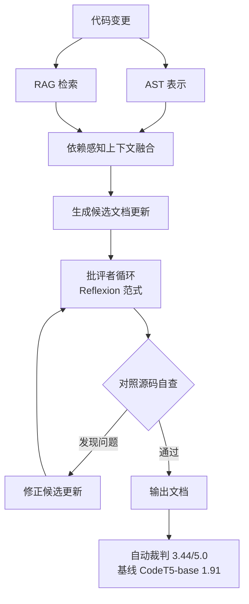

# 结构检索加批评者迭代的文档维护

> 论文：https://arxiv.org/abs/2605.02163
> 名称：DocSync: Agentic Documentation Maintenance via Critic-Guided Reflexion

## 基本信息

| 项目 | 内容 |
|------|------|
| **链接** | https://arxiv.org/abs/2605.02163 |
| **发布时间** | 2026-05 |
| **一句话总结** | 融合 AST 表示与 RAG 提供依赖感知上下文，再用 Reflexion 范式的批评者循环让模型对照源码自我修正，LoRA 小模型达到自动裁判 3.44/5.0（基线 CodeT5-base 为 1.91） |
| **本文对应** | 子问题三（内容覆盖率） |

## 置信度评估

| 信号 | 评估 |
|------|------|
| 发表场所 | arXiv 预印本（2026-05） |
| 引用/影响 | 低（新发布） |
| 代码可用 | 未查到公开实现 |
| 实验设计 | 中（用 LoRA 小模型的资源受限实现，在替代任务上评测） |
| **综合置信度** | **🟡 中-高** |
| 需谨慎点 | 论文自述评测是「proxy code-to-text maintenance task」（替代任务），不是真实维护流程；绝对分数来自自动裁判，非人工 |

## 它解决了什么问题

论文开头把这个问题的**工具能力空隙**说得很准，这段值得全文照引：

> 静态分析工具能检测文档的缺失，但**无法评估其语义一致性**。反过来，标准 LLM 提供生成灵活性，但**在更新文档时经常产生幻觉**，缺乏对底层代码的深层结构认知。

也就是说两端各缺一半：

- **静态分析**能判「有没有文档」，判不出「文档说得对不对」
- **纯 LLM**能说自然语言，但**不知道代码结构**，更新时会编

论文要补的就是这个中间地带。

## 方法核心

两个机制叠起来：**结构感知的上下文供给**与**批评者引导的迭代修正**。

**机制一：AST 加 RAG 的上下文融合。** 论文的表述是「通过融合抽象语法树表示与检索增强生成，提供**依赖感知的上下文**」。这一层专门解决「缺乏对底层代码的深层结构认知」这个失败模式。

**机制二：批评者引导的修正循环。** 基于 **Reflexion 范式**，让模型**对照源码自我修正候选更新**，以保证事实一致性。

### 最关键的实测结论

论文有一句结论对本项目最重要：

> **迭代批评循环带来可测量的语义正确性提升，且不需要增大参数量。**

这句话的含义是：**改善架构比增大模型更有性价比**。论文的实现用 **LoRA 适配的小模型**，明确标注为「资源受限实现」（resource-constrained implementation）。在这个限制下，它仍然大幅超过编码器-解码器基线。

## 关键数据

| 指标 | DocSync | 基线 CodeT5-base |
|---|---|---|
| 自动裁判分 | **3.44 / 5.0** | 1.91 |
| 语义对齐 | 大幅优于基线 | 基线 |
| 摘要行忠实度 | 大幅优于基线 | 基线 |
| 模型规模 | LoRA 适配小模型 | 编码器-解码器 |

**要读出的两点**：

1. **3.44 对 1.91 是明显差距**，但绝对值 3.44/5.0 说明**没到「基本正确」的程度**。论文的定性结论是「有希望的方向」，用词是「highly promising direction」
2. **分数来自自动裁判**，有人工裁判偏差的风险。本目录另一篇的教训（`2608.00884`）说明模型裁判可能依赖捷径信号。**引用这个数字时应标注它是自动裁判分**

## 局限

- **评测是替代任务**（proxy code-to-text maintenance task），不是真实的文档维护流程。论文自己这么标注
- **自动裁判分而非人工评分**，绝对值不宜直接采信
- **未报告覆盖率类指标**。论文报的是语义对齐、摘要行忠实度、裁判偏好，**没有「改动是否被完整记录」的度量**。这与本项目 Q3 想解决的不是同一件事
- **未查到公开实现**
- **未报告运行开销**。批评者循环意味着多次模型调用，成本高于单次生成
- **依赖 AST 解析质量**，对解析器不支持的语言或语法会退化

## 对本项目的启发

### 方案要点

**这篇对本项目最大的价值落在它对工具能力边界的界定，以及「AST 加 RAG 提供依赖感知上下文」这个具体做法，方法本身反而次要。**

那句「静态分析能检测缺失但无法评估语义一致性，LLM 有灵活性但缺乏结构认知」**正好界定了本项目三件事的分工**：

| 问题 | 该用什么 | 因为 |
|---|---|---|
| 改动有没有文档 | 静态分析 | 可枚举、可判定 |
| 文档说得对不对 | 执行验证 | 需要行为基准 |
| 改动影响到哪些文档 | AST 加依赖图 | 需要结构上下文 |

### 三条可操作的结论

1. **判断覆盖率需要依赖感知上下文，不是把 diff 全丢给模型**。这是本篇给 Q3 最具体的机制：**要判断某条改动是否被某张卡片覆盖，需要知道这条改动涉及的文件与卡片描述的文件之间有没有依赖关系**。没有这层信息，模型只能在词汇层面猜
2. **迭代修正优于一次成型**。论文实测批评者循环带来可测量提升**且不需要更大模型**。对本项目的含义：覆盖率判定或一致性判定**不必追求一次做对**，可以让模型对照源码迭代收敛。这与「增量维护」专题里 Skill Drift 的发现一致（结构化失败契约让修复率从 10% 提到 78%，成本低于三轮反思）
3. **「资源受限下架构比规模更重要」这条对项目有利**。项目只能用公司本地部署的模型，选型受限。**DocSync 用 LoRA 小模型加正确架构达到可用水平**，说明这个限制不是致命约束。同样的结论在「文档相似度」专题里也有（`2512.19883` 用 CodeT5+ 中等模型打赢大模型）

### 需要注意的一处口径差异

DocSync 解决的是「**文档过时了，怎么更新它**」，本项目 Q3 问的是「**改动是否被记录**」。**两者相邻但不同**：

- DocSync：已知要更新，问更新得对不对
- 本项目：不知道有没有记录，先问记录全不全

**因此这篇的方法可以借用（AST 加 RAG 加迭代），但它的评测口径（裁判分）不能直接用作覆盖率指标。** 覆盖率需要的是可枚举的分母，这一点本目录 README 里给了具体的中间指标设计。

### 与既有设计的衔接

- **`CheckAgent.md` 第 64 行**「不把编号索引、相似度算法或新的代码检测系统作为实现前提」。**AST 表示与依赖图属于「程序提取」范畴**，是本项目已有能力（CheckAgent 已用词法边界提取函数与声明）的延伸，边界上说得通
- **`DocGenAgent.md` 第 10 行** DocGen「负责组织内部 DocWorker、汇总片段、处理重复与矛盾」。DocSync 的批评者循环对应的是「汇总后的自查」这一步
- **项目的证据要求**：DocSync 的批评者循环**对照源码**修正，产出的理由应当指向具体源码位置，符合「每条结论附可点击证据」的要求
