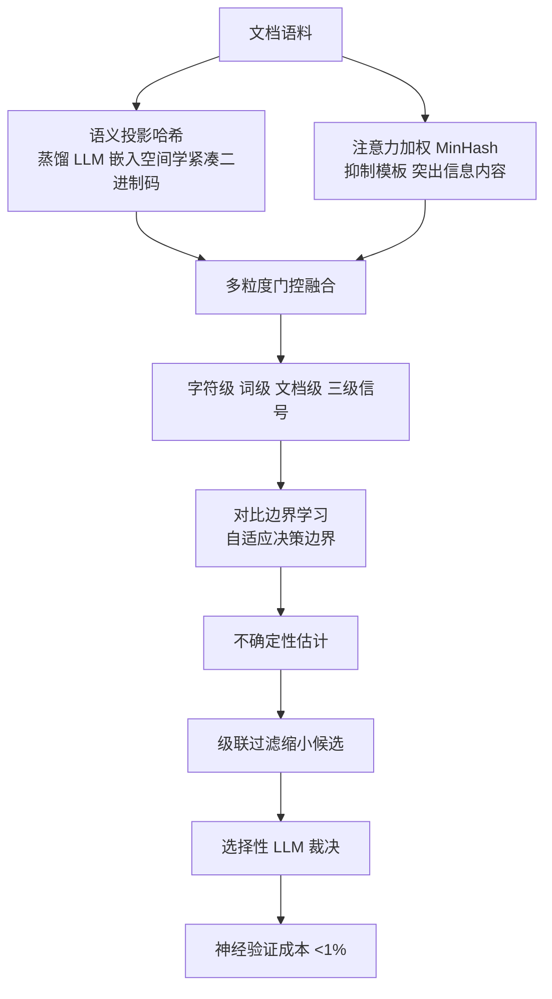

# 语义哈希与多粒度去重

> 论文：https://arxiv.org/abs/2607.01601
> 名称：SemHash-LLM: A Multi-Granularity Semantic Hashing Framework for Document Deduplication

## 基本信息

| 项目 | 内容 |
|------|------|
| **链接** | https://arxiv.org/abs/2607.01601 |
| **发布时间** | 2026-07 |
| **一句话总结** | 把语义投影哈希、注意力加权 MinHash、对比边界学习与选择性 LLM 裁决统一到一套框架，字符/词/文档三级信号门控融合后级联过滤，神经验证成本低于 1% |
| **本文对应** | 子问题一（语义相似度） |

## 置信度评估

| 信号 | 评估 |
|------|------|
| 发表场所 | arXiv 预印本（2026-07） |
| 引用/影响 | 低（新发布） |
| 代码可用 | 未查到公开实现 |
| 实验设计 | 中（覆盖多个抗性场景，但具体基准未在摘要说明） |
| **综合置信度** | **🟡 中-高** |
| 需谨慎点 | 未给出基准名称与具体指标数值；「成本低于 1%」的参照系未在摘要中说明 |

## 它解决了什么问题

大规模文档去重有两个必须同时满足的要求：**保持语义等价**，同时在**海量语料上保持效率**。这两者有张力：纯哈希快但抓不到语义改写，纯模型准但成本随规模线性上升。

论文针对的还有几类**边界场景**，它们是去重实际落地时最容易出问题的地方：

- **模板污染**：大量文档用同一模板生成，表面高度相似但内容不同
- **短文本扰动**：短文本改几个词就实质不同，但向量仍接近
- **包含关系**：一段文本完整包含另一段，是否算重复取决于策略
- **病毒式片段**：被大量复制的片段

## 方法核心

四个部件统一在一套框架里，形成**级联过滤**流程。

**部件一：语义投影哈希。** 在**蒸馏的 LLM 嵌入空间**里学习紧凑二进制码。这一步兼顾了语义（来自 LLM 嵌入）与效率（二进制码可直接算汉明距离）。

**部件二：注意力加权 MinHash。** 这是针对模板污染的关键设计：**抑制样板文本、突出信息内容**。标准 MinHash 对模板化文本会给出虚高的相似度，注意力加权把权重压到实际有信息的部分。

**部件三：对比边界学习 + 不确定性估计。** 用**自适应决策边界**替代固定阈值，并做不确定性估计，从而在模板污染、短文本扰动等场景下保持稳健。

**部件四：选择性 LLM 裁决。** 只在**级联过滤剩下的少数候选**上调用模型。这是成本控制在 1% 以下的机制来源：**模型不参与全量比对，只做最后裁决**。

## 关键数据

| 指标 | 论文表述 |
|---|---|
| 去重质量 | 「强」（strong duplicate detection quality） |
| **神经验证成本** | **低于 1%** |
| 抗性场景 | 模板污染、短文本扰动、包含关系、病毒式片段 |

**「成本低于 1%」是本篇对本项目最关键的单一数字**：它意味着**全量去重可以放进每次生成的流水线**，而不需要攒批处理。

## 局限

- **未给出具体基准与指标数值**。摘要只说「strong」，没有 precision/recall/F1 数字，因此无法与其他方法直接横向比较
- **「低于 1%」的参照系未说明**。是相对全量 LLM 比对、还是相对某个基线，摘要层面不清楚。**引用这个数字时必须带上这个限定**
- **未查到公开实现**，四个部件（投影哈希、加权 MinHash、对比学习、LLM 裁决）都需要自己实现
- **多粒度门控融合的参数量与训练成本未报告**
- **选择性 LLM 裁决的触发条件未在摘要中说明**。这是成本控制的关键，需读全文

## 对本项目的启发

### 方案要点

**这是知识卡片去重最实用的一篇，因为它针对的场景与本项目高度重合：模板污染。**

知识卡片由流水线按固定格式批量生成，句式与结构高度相似。**标准向量相似度在这种语料上会系统性偏高**，这正是纯 Embedding 路线在本项目不可用的首要原因。注意力加权 MinHash 是直接针对这个问题的设计。

### 三条可操作的结论

1. **去重设计要按成本分层，模型只处理最后一层**。SemHash-LLM 的四层结构给出了一条可照搬的阶梯：**二进制哈希粗筛 → 多粒度信号融合 → 自适应边界判定 → 少量候选上模型**。对本项目的含义是：**不要一上来就用模型比对所有卡片对**
2. **抗性场景清单应当成为本项目去重评测的用例集**。论文列的四类场景（模板污染、短文本扰动、包含关系、病毒式片段）里，**前三类在本项目都会出现**：卡片模板化（模板污染）、短卡片（短文本扰动）、一张卡片描述的内容被另一张部分包含（包含关系）。**建议按这四类各构造几个用例来验收去重效果**
3. **「包含关系」需要有明确策略**。部分包含算不算重复，取决于业务。放到本项目：**一张卡片讲某个接口的用法、另一张讲该接口的实现细节，是否该合并**？这个判据项目当前没有，需要先定

### 一个需要注意的口径问题

论文的「成本低于 1%」是在**文档去重**场景下测的。项目场景有两个差异：

- 卡片的**绝对规模小得多**（每天一批，不是海量语料），因此成本压力不如论文场景大
- 但卡片的**模板化程度更高**，因此语义判定的难度更大

**结论：可以借鉴分层架构与抗性场景清单，但不要直接把 1% 当作本项目的成本目标。**

### 与既有设计的衔接

- **`Knowledge.md` 第 13 行**已有「**同模块同正文可去重**，修订创建新版本」。这是**精确去重**（同正文），本专题要补的是**语义去重**（不同表述但同一件事）
- **`DocGenAgent.md` 第 67 行**要求「关键词非空、**不重复**且无首尾空白」。这是卡片内部的约束，语义去重是卡片之间的约束
- **`DocGenAgent.md` 第 10 行**的「处理重复与矛盾」职责，本篇覆盖「重复」这一半
