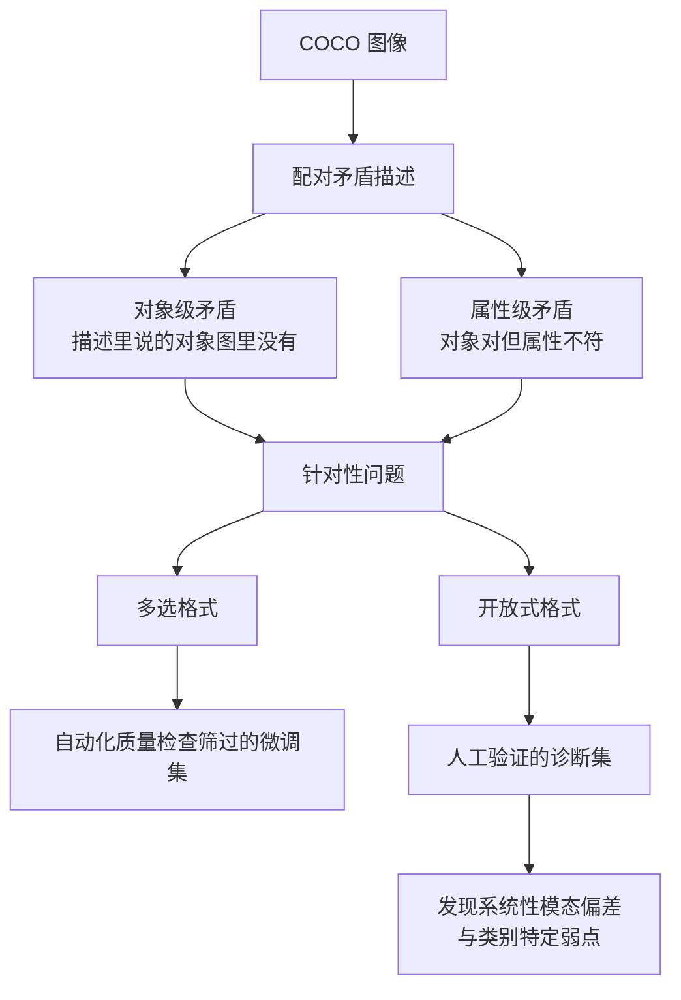

# 跨模态矛盾检测基准

> 论文：https://arxiv.org/abs/2511.19199
> 名称：CLASH: A Benchmark for Cross-Modal Contradiction Detection

## 基本信息

| 项目 | 内容 |
|------|------|
| **链接** | https://arxiv.org/abs/2511.19199 |
| **发布时间** | 2025-11 |
| **一句话总结** | 提出跨模态矛盾检测基准，把矛盾分为对象级与属性级两类，发现当前最先进模型在识别跨模态冲突上有系统性偏差与类别特定弱点 |
| **本文对应** | 子问题一（矛盾识别） |

## 置信度评估

| 信号 | 评估 |
|------|------|
| 发表场所 | arXiv 预印本（2025-11） |
| 引用/影响 | 低（新发布） |
| 代码可用 | 论文声明提供微调集与人工验证的诊断集 |
| 实验设计 | 好（自动化质量检查筛过的微调集加人工验证诊断集，多选与开放式两种格式） |
| **综合置信度** | **🟡 中-高** |
| 需谨慎点 | 场景是图像与描述（多模态），不是卡片与代码；分类法可借鉴，实验结论不可直接外推 |

## 它解决了什么问题

论文指出一个被普遍忽略的问题：**现实场景里矛盾的多模态输入很常见，但现有基准通常假定输入是一致的**，因此**没有评估跨模态矛盾检测**这项能力。

而这项能力是「防止幻觉、保证可靠性」的基础。如果模型拿到两张互相矛盾的输入（比如一张图和一句与图不符的描述），它应当指出来，而不是顺着其中一个往下编。

## 方法核心

CLASH 的构造方式是**受控的矛盾注入**。

**关键设计一：矛盾分两类。**

- **对象级矛盾（object-level）**：描述提到的对象在图中不存在
- **属性级矛盾（attribute-level）**：对象对得上，但属性不符

**关键设计二：两种评测格式。** 多选与开放式同时评测，避免单一格式掩盖能力差异。

**关键设计三：两个数据集，各有分工。** 微调集规模大、经自动化质量检查；诊断集规模小、**经人工验证**。**这个分工值得借鉴**：调优用自动筛过的数据，评测用人工确认的数据。

### 实测发现

论文对当前最先进模型的分析揭示了**实质性局限**：模型在识别跨模态冲突上有**系统性模态偏差**（systematic modality biases）与**类别特定弱点**（category-specific weaknesses）。论文还实证了针对性微调能显著提升冲突检测能力。

## 关键数据

论文摘要**未给出具体准确率数值**。报告的是定性发现：模型存在系统性偏差与类别弱点，针对性微调有显著提升。

## 局限

- **场景是图像与文本**，不是卡片与代码。本项目要处理的是两段自然语言（卡片间）或自然语言与形式语言（卡片与代码）
- **未报告具体数值**，无法用于设定指标基线
- **矛盾是受控注入的**，与真实场景里矛盾的多样性和隐蔽性有差距
- **图像侧的矛盾有明确的对应物**（图里的对象），而代码侧的「矛盾」边界更模糊
- 基准面向多模态大模型，本项目用本地部署模型，适配性需自测

## 对本项目的启发

### 方案要点

**CLASH 对本项目最有价值的是它的矛盾分类法，而不是它的实验结论。**

「两张卡片矛盾」听起来是一个问题，实际是几类不同的问题，**识别难度与处理动作都不同**。CLASH 的对象级/属性级二分给出了一条可借用的切分线：**矛盾出在「有没有」还是「对不对」**。

### 三条可操作的结论

1. **矛盾识别要先分类，再分别设计判据**。把 CLASH 的分类法映射到卡片场景：

| 矛盾类型 | 卡片场景表现 | 判据 | 处理动作 |
|---|---|---|---|
| 对象级 | 一张卡片提到某接口/字段，另一张完全没提，或代码里根本没有 | 符号存在性检查（确定性） | 删除无依据内容 |
| 属性级 | 同一个接口，两张卡片说的参数/返回值/行为不同 | 原子事实对齐 | 拉出人工评审 |
| 数值/阈值级 | 同一行为的边界条件描述不同 | 直接比对 + 执行验证 | 以执行结果为准 |

**这张表可以直接作为本项目矛盾识别的最小判据集**。注意第一类可以靠确定性检查（符号是否存在），不必动用模型。

2. **评测集要分「调优用」与「诊断用」两份**。CLASH 的做法是微调集大而自动筛、诊断集小而人工验。**落到本项目**：自建评测集里，用于日常回归的可以大一些，用于判定方案是否有效的必须小规模人工确认。**两者不能混用**，否则优化会在自动筛过的数据上过拟合
3. **「系统性偏差」这个发现提示要做分项报告**。CLASH 发现模型有**类别特定弱点** —— 某些类别的矛盾就是识别不好。**对本项目的含义是：一致性/矛盾判定必须按类型分别报告准确率**，总体数字会掩盖某一类基本判不准。这与本目录另一篇（注释坏味检测只报总体准确率看不出失败集中处）的结论一致

### 一处需要谨慎的映射

CLASH 的「模态差异」是**视觉与语言**，本项目的「跨模态」是**自然语言与代码**。两者难度不同：

- 图文矛盾有明确的对应物（图中对象可枚举）
- **代码行为的边界更模糊**，一段代码「做了什么」本身就需要执行或分析才能确定

**因此 CLASH 的分类法可以借，但不要预期相同的检测难度。** 本项目卡片与代码的一致性判定，仍然应当以执行验证为主（见本目录「文档测试验证注释准确性」）。

### 与既有设计的衔接

- **`DocGenAgent.md` 第 10 行** DocGen「处理重复与矛盾」。本篇提供矛盾的分类依据，「重复」那半由本目录另两篇（原子事实对齐、语义哈希）覆盖
- **项目的证据要求**：上表里对象级矛盾可以靠符号存在性检查判定，这类判定**产出的是确定性证据**（符号在不在代码里），可直接作为可点击证据
