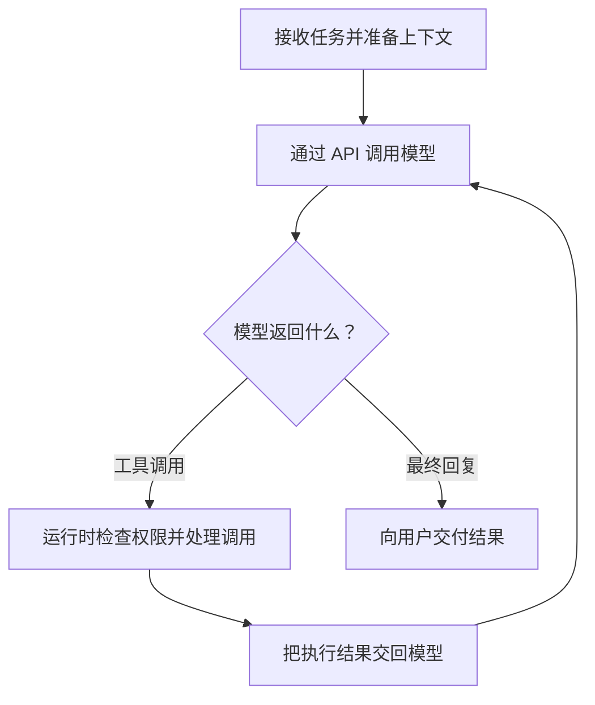

# 01｜从 Claude 到 Claude Code：模型、API 和 Agent 框架有什么区别？

平时聊 AI 编程，经常会听到「我用 Claude」或「我用 Codex」。前一句可能在说模型，也可能在说聊天产品。后一句通常是在说一套能进仓库读代码、改文件、跑测试的编程工具。评估两个人的使用体验之前，可以先问一句：**你用的是什么模型，通过什么工具在做什么任务？**

## 先把市场上的名字对上

| 层次 | 它负责什么 | Anthropic 的例子 | OpenAI 的例子 |
| --- | --- | --- | --- |
| **模型（LLM）** | 根据收到的上下文生成文本、代码，或提出下一步工具调用 | Claude 模型家族，例如 Claude Opus | GPT-6 系列，例如 GPT-6 Astra |
| **模型 API** | 让程序选择模型、传入消息和工具定义，并接收模型输出 | Claude Messages API | OpenAI Responses API |
| **Coding Agent 产品** | 给你一个可以指派编程任务的入口，背后有运行时连接模型和工作区 | Claude Code | Codex，例如 Codex CLI |

Claude 也用于命名 Anthropic 的聊天产品，OpenAI 对应的聊天产品叫 ChatGPT。Codex 也出现在某些具体模型名中，例如 GPT-5-Codex。遇到这类名字，可以看它出现的位置：模型选择器里的具体名称通常是模型，终端里启动的 `codex` 是工具。  
[Claude Messages API](https://platform.claude.com/docs/en/api/messages/create) · [OpenAI 模型目录](https://developers.openai.com/api/docs/models) · [OpenAI Codex 文档与教程](https://developers.openai.com/learn/codex)

## 同一个任务，两种做法

假设你在一个公开练习仓库里遇到一个问题：

> 配置文件写了 `timeout: 0`，程序却用了默认的 30 秒。定位原因，修复，并补一个回归测试。

**直接调模型 API。** 你的脚本把问题、相关函数和测试代码发给模型。模型可能指出 `timeout = value or 30` 会把 `0` 当成假值，并返回一个补丁和测试示例。如果脚本只是发送请求、打印响应，你仍需要自己应用补丁并运行测试。

**用 Claude Code 或 Codex。** 在已授予相应权限的练习仓库里，工具可以先搜索配置解析代码，把相关文件内容交给模型判断，再执行编辑、运行测试。测试失败时，运行时会把真实输出交回模型，模型可以据此再查一轮或调整修改。最后你可以用 diff 和测试输出核对实际结果。  
[Claude Code 的工作方式](https://code.claude.com/docs/en/how-claude-code-works) · [Codex CLI](https://learn.chatgpt.com/docs/codex/cli)

## 谁在调用工具？

模型支持工具调用时，可以返回类似「调用 `run_tests`，参数是 `test_config.py`」的结构化请求。**提出调用和执行调用是两步。** 如果 `run_tests` 是应用自定义的工具，应用或 Agent 运行时负责检查权限、执行命令，再把退出码和输出交回模型。如果是 API 提供方托管的工具，执行可以发生在服务端。

这也是自己用模型 API 搭 Agent 的起点。给模型定义工具，再由代码处理工具执行、结果回传和停止条件，就有了一个基本的 **Agent 循环**。成熟的编程工具还会处理项目指令、会话上下文、文件与终端权限，以及工具失败后的反馈。  
[Claude 工具调用](https://platform.claude.com/docs/en/agents-and-tools/tool-use/overview) · [OpenAI 函数调用](https://developers.openai.com/api/docs/guides/function-calling)

## 「Agent 框架」和「Coding Agent 产品」怎么叫更准确？

日常交流里，大家常把 Claude Code、Codex 一起叫作「Agent 框架」。讨论架构时，可以再细分一层：

- **Coding Agent 产品**是你直接打开使用的工具，例如 Claude Code、Codex。
- **Agent Harness（Agent 运行时）**是产品里把模型、上下文、工具、权限和执行循环接起来的部分。
- **Agent 框架或 SDK**是给开发者用来构建自己 Agent 的库或开发工具。你可以基于它定义工具、接入模型并编排任务。

## 选型时怎么用这个区别？

| 你现在想做什么 | 从哪里下手 |
| --- | --- |
| 在自己的程序里给日志分类，或把文本提取为结构化数据 | 先看模型和 API 是否支持所需的输入、输出和调用方式 |
| 让 AI 直接在仓库里查问题、改文件、跑测试 | 先看 Coding Agent 的工作区、权限、工具和支持的模型 |
| 把多轮查资料、调用业务接口和校验结果接到自己的系统里 | 看 Agent 框架或 SDK，也可以从模型 API 和一个小型工具循环开始 |

所以，「Claude Code 和 GPT-6 哪个写代码更好」可以拆成两个能实际验证的问题：**比较模型**时，尽量固定同一工具、仓库版本和任务，只切换它支持的模型组合。**比较成品工具**时，用同一仓库版本、任务和验收标准分别跑 Claude Code 和 Codex，记录各自的模型与配置，检查测试通过情况、改动范围和人工介入次数。如果两款产品各自使用不同模型，测到的是两套组合的端到端表现。  
[Codex 支持的模型与配置示例](https://learn.chatgpt.com/docs/models)
